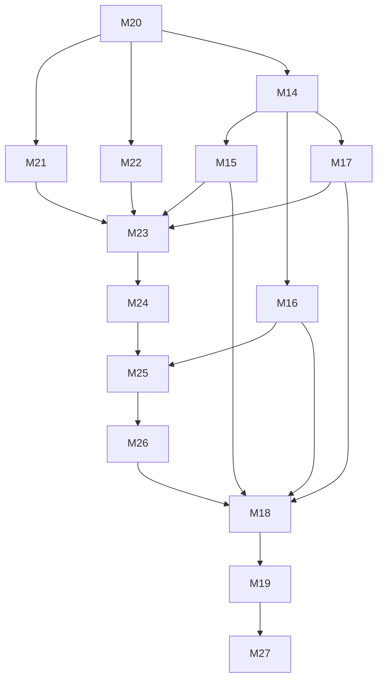

# Development Plan — VaultMind Reliable Continuity

Plan ID: `VM-CONTINUITY-2026-10-21-R2`. Revision: R2, 2026-10-21. Status: planning contracts prepared locally; no implementation authorization until the reviewed versioned-contract bootstrap and each current design gate. Repository: `Mathews-Tom/VaultMind`. `ISSUE_TRACKING: off`. Stack-depth cap: 6 implementation PRs per milestone, excluding a conditional docs-only prerequisite.

## 1. Context & Source Map

VaultMind is a feature-rich alpha, not a rebuild candidate. This programme completes the unmerged remediation and adds the smallest governed raw-to-wiki and objective-to-artifact-to-approval-to-memory-to-resume slice justified by the current source audit and analysis. Canonical Markdown, structured episode lifecycle, rebuildable indexes and one-way OKF export retain distinct ownership; feature presence, deterministic fixture proof, native-model qualification and actual user value are different evidence classes.

Authority order: the current user request and explicit automation/spend/tracking decisions; these revised contracts once reviewed and merged; current source and external delivery evidence; preserved historical contracts/evidence; the RFC `.docs/VaultMind_Investigation_and_Enhancement_Strategy.md` as a candidate strategy, not proof of implementation. The video [Obsidian in 24 Minutes](https://www.youtube.com/watch?v=4Hvkv_I8QDE) supplies a design pattern (16:30 wiki level, 19:30 raw/wiki/schema, 20:20 ingest/query/lint, 21:20 catalog, 22:00 log), not reliability evidence. Source paths below were inspected during planning; line numbers move after implementation.

| ID | Evidence / source | Remaining disposition |
| --- | --- | --- |
| R01 | RUN-VERIFIED clean-clone acceptance failure after PR97; CODE-VERIFIED scripts/verify_acceptance.py::artifact_identity and .github/workflows/ci.yml | M20 restores shipped-default acceptance and standalone CI. |
| R02 | CODE-VERIFIED config.py::Settings.from_toml/load_settings; tests/test_config.py; RFC §5/§14 | M21 fixes precedence and proves consumer reachability; dormant fields remain unshipped. |
| R03 | CODE-VERIFIED mcp/server.py::call_tool/dispatch, mcp/auth.py, existing docs/mcp-integration.md scope warning; RFC §8-9 | M22 scopes every result surface, not merely input paths. |
| R04 | Existing M14/PR96, indexer/store.py, vault/watch_handler.py and preserved original native-event failure; prior plan G04 | M14 retains full original acceptance and causal hold. |
| R05 | sources/pipeline.py write/finalize/cursor ordering, services/review_queue.py; prior G05; RFC §3/§8 | M15 durable finalization for all three existing connectors. |
| R06 | bot/thinking.py pre-response gap proxy; graph/evolution.py and real bot/scheduled callers; prior G06 | M16 outcome-based gaps and actual stale-claim minting. |
| R07 | contradiction eval/detector/config; prior G07 and R1-A positive qualification reconciliation | M17 fail-closed eligible evidence and positive/single-field-negative marking controls. |
| R08 | review_queue.py approval/apply path; fragmented canonical writers; RFC §5-6/§9/§15 | M23 exact-action governed writes, cross-process claims, migrations/restore and ADR-005/008. |
| R09 | sources/pipeline.py raw preservation gap; export/okf.py export-only catalog/log; video at 19:30-22:00; RFC §6/§8 | M24 opt-in raw-to-curated wiki, live catalog/log/lint, retention and ADR-006; OKF remains one-way. |
| R10 | scheduler.py state/last_run is not objective completion; memory/store.py; RFC §5-7/§10-11/§14 | M25 bounded linear cited-memo workflow, context, approval, decision and resume; ADR-001/002/003/004. |
| R11 | bench/runner.py actual recall route; starter benchmarks/golden.yaml; RFC §8/§12/§14 | M26 frozen 100-document offline outcomes, route/ablation inventory and ADR-007; no default tuning. |
| R12 | Prior G08, R1-A cumulative campaign controls and exact M18/A1-A3 contracts | M18 single inherited 40-start OMP campaign after all relevant changes; no reset under R2. |
| R13 | Prior G09/M19 installed-wheel and docs closeout | M19 closes inherited remediation read-only after M18; does not close the expanded programme. |
| R14 | RFC §3/§15-18 and current analysis: feature-rich alpha, operational evidence gaps, no rebuild | M27 final existing-doc/source/ownership/threat/ADR/disposition reconciliation; verified automation is not adoption. |

### Verified baseline and current holds

| Area | Observed state | Treatment |
| --- | --- | --- |
| M1-M10 | Previously merged feature baseline: capture/retrieval/graph/episodes/autonomy/connectors/lineage/OKF. | Preserve; no duplicate runnable goals. |
| M11 | PR91/92 merged: retrieval confidence/acceptance/quality foundation. | Historical merged prerequisite; not reimplemented. |
| M12 | PR93 merged: MCP registration/stdio acceptance boundary. | Preserve; M22 strengthens all output scoping. |
| M13 | PR94/95 merged: callback authorization and truthful review execution. | Preserve; M23 adds exact-action/concurrency guarantees without regressing callback policy. |
| Current main | `efeef42`, PR97 removed tracked .docs contracts; package version 0.1.0. | Restore only two contracts by bootstrap; do not restore the entire deleted directory. Recheck actual main before execution. |
| Fresh tracked-only main checks | Ruff check/format and strict source mypy passed; 1637 tests passed; actual CLI help/version and canned-bundle bench worked in isolated state. | RUN-VERIFIED mechanics only; not real retrieval quality or production readiness. Do not rerun unchanged checks just for this docs update. |
| Shipped acceptance | retrieval/mcp/approval each failed before scenarios/receipts with FileNotFoundError reading the deleted plan/prompts in artifact_identity(). | M20 repair and standalone CI; passing unit tests did not cover this shipped path. |
| M14 / PR96 | OPEN at `1183f8b1378bc9f365fb9563bcf15391ff777332`, tree `22961574aa03557f46857d70229d473fd988e624`; no merge despite green checks. | Preserve causal hold below; inspect current provider state before acting. |
| M15-M19 | Historically blocked and not completed. M18 campaign historically unallocated/unrun. | Preserve identities/acceptance; verify durable accounting rather than assume unused authorization. |
| M20-M27 | Newly planned remaining capabilities. | No implementation, review, merge or runtime success is claimed by this planning revision. |

M14 is NOT MERGEABLE despite three green checks on PR96. The original first-log.md native-filesystem event timed out after 20 seconds; its causal mechanism remains unproved/unrepaired. Original report SHA-256: e42c6e64c9bbe3f9cc7431f0c86f2736c130ce0f4904e34bfaea6728682d88dd. The later authorized passive full-suite trace passed but did not capture that failure (report SHA-256 9afd2895a373b95578a122fc77d15a62cb882231622375590cf9ae4a340c500d). The public hold is https://github.com/Mathews-Tom/VaultMind/pull/96#issuecomment-6127096389. Preserve the original evidence and frozen substantive observations in the local history/PR evidence. Do not repeat until green, widen waits, nudge files, replace native events with polling/mocks, skip/xfail or invent a cause. A genuine matching failed recurrence with its own write/native/queue/handler trace and demonstrated cause-specific repair is still required. If unavailable, retain NO-GO; changing this frozen acceptance requires explicit user authorization, not routine automatic reconciliation.

### Complete strategy disposition

All candidate strategy topics have an implemented, bounded or explicit deferred disposition; a deferred hypothesis is not a hidden success criterion or permission for scope expansion.

| Source requirement / candidate | Disposition and evidence needed | Owner |
| --- | --- | --- |
| RFC W1/W2/W5 inventory, ownership, threat/recovery, baseline, ten risks, migration/restore | Implement within existing docs and assigned decision records; label CODE-VERIFIED/RUN-VERIFIED/USER-OBSERVED/HYPOTHESIS. Preserve failures and copied-fixture restore proof. | M20, M23-M27 |
| RFC W3/H1-H6: 20 actual tasks, 30 captures, reuse after a week, acceptance/effort/cost; provisional 95% resume / 90% provenance / 80% acceptance / 30% fewer human steps | Separate optional human-evidence track; not performed and not fabricated by fixture engineering. Targets remain hypotheses until a frozen study with sample sizes/uncertainty. No user-value claim or expansion approval follows automatically from offline GO. | M26 records protocol; M27 discloses unqualified evidence |
| RFC W4/§15 Firstmate references | Corrected by the current analysis to Hermes. No integration, compatibility/license assertion or framework adoption without inspecting the exact project/version and comparative recovery/permissions/cost evidence. Minimal in-house linear runtime is the chosen bounded slice, not a claim that alternatives lose. | ADR-004 in M25; external integration deferred |
| RFC general DAG, concurrency, retries/backoff, parallel specialists and phase-4 connector expansion | Defer general orchestration and more connectors until the single pilot proves accepted outcomes. M25 implements only linear bounded steps, deadlines/budgets, cancellation/checkpoints/idempotent explicit recovery; no generic retry daemon. Existing three connectors are repaired by M15. | M25; expansion not authorized by this train |
| Meeting follow-through, autonomous commitment notifications, broad natural-language bot routing, dashboard | Architecture-memo and interrupted-resume are the complete first pilot. Meeting extraction/owners/deadlines, proactive follow-up and new UI require actual workflow/notification evidence; do not invent commitments or external tasks. Existing expert bot commands remain. | M25 progress/intent CLI; later scope deferred |
| More graph/maturation/reranking/activation/procedural intelligence | Keep existing features; inventory and ablate only genuinely wired mechanisms before expansion/removal/default flips. No independent evidence of user-important incremental lift exists yet. | M26; expansion deferred |
| Full rewrite, duplicate canonical knowledge store, OKF write-back | Reject for this train: no verified systemic limitation justifies migration risk. Markdown owns approved knowledge, episodes own decision lifecycle, runtime owns run state; all indexes and exports are derived. | M23-M27 ownership invariants |
| Native SDK/hosted embeddings, private-vault qualification, production deployment/migration, real Telegram sends or external effects | Separate explicit human authorization, credentials and bounded spend/rollback/evidence required. They are not hidden fixture acceptance requirements and are not authorized by a merge. | M17-M19/M27 limitations |
| Open PR86 SQLite batching and PR87 Chroma upsert-size changes | Inspect actual status/scope at design gates; preserve or defer separately, never auto-adopt unreviewed changes or claim their benefit. | M20/M27 evidence reconciliation |

## 2. Assumptions & Gaps

> ASSUMPTION: Prefer a modular-monolith refactor and one linear cited-memo pilot. No code evidence justifies a rewrite, duplicate canonical store or broad agent/DAG platform.

> ASSUMPTION: Maximum automation means routine repository decisions, fixture verification, independent reviews, CI remediation and permitted merges proceed unattended; it does not create human approvals, production access, native API credentials or new spending authority.

> ASSUMPTION: Keep the user-approved OMP implementation vehicle and inherited single bounded OMP fixture campaign. The R2 Plan ID cannot reset the legacy M18 start/reservation ledger or create a new qualification campaign.

> ASSUMPTION: Existing version 0.1.0 remains unchanged; target unversioned, required release artifacts none, publication not requested. Per-feature docs changes are required; a release CHANGELOG/version bump is not.

> GAP: M14's original native-event cause is still unproved/unrepaired. This blocks M14 acceptance and its dependent closure only, not independent M20/M21/M22. No acceptance waiver is authorized.

> GAP: Actual user workflow/adoption traces, native-provider/hosted-embedding qualification and production operating proof are unavailable. Keep them visibly unqualified; do not block isolated development on invented human measurements or claim that fixtures replace them.

> GAP: Effective GitHub permissions and any required human reviewer approval must be read at execution. Automatic merges are conditional on actual policy; no bypass is authorized.

## 3. Dependency Graph

Edges are only remaining-milestone dependencies. M11/M12/M13 are already merged baseline prerequisites as specified in the milestone rows; they are not runnable graph nodes. Bootstrap precedes every remaining node.



M20 has no unfinished predecessor. M21 and M22 depend on M20 and remain independent of M14; serialize them because they share runtime/verification files. M15/M16/M17 require merged and verified M14. M18 is deliberately delayed until M26 so the sole authorized campaign runs after all code that can affect its bound identities. M19 is frozen remediation closeout; M27 is final expanded-programme closeout.

Serialization is execution policy, not an extra dependency: select the earliest dependency-ready milestone in the preferred order, run one implementation lane at a time, and recompute readiness after every merge/NO-GO. M15/M16/M17 are sibling nodes but must not overlap implementation under this profile. The preferred list is one conservative topological schedule, not a replacement for the DAG. M25 inherits M15/M17 through M24 -> M23; M27 inherits every other remaining node through M19 -> M18 -> M26 -> M25 -> M24 -> M23 and the explicit prerequisite edges.

## 4. Release Trains

| Target release | Included milestones | Preparation trigger | Required artifacts | Verification | Publication |
| --- | --- | --- | --- | --- | --- |
| unversioned | M20,M21,M22,M14,M15,M16,M17,M23,M24,M25,M26,M18,M19,M27 | All included milestones externally merged and verified; canonical M27 evaluates preparation once. | none | uv run vaultmind --version reports 0.1.0; final offline/WHEEL/read-only receipt gates. | not requested |

M11-M13 remain historical prerequisites, not members to rerun. RELEASE PREP: not-required throughout because required artifacts are none; incomplete train status is still reported. No release-captain, tag, hosted release or package publication is triggered. M27 is the only final preparation/disposition owner; M19 no longer terminates the expanded programme.

## 5. Plan Evolution Protocol

### Versioned-contract bootstrap

The two current contracts are local ignored snapshots after PR97 deleted their tracked predecessors. Before any product milestone, canonical opens one reviewed docs-only bootstrap, `docs(plan): restore vaultmind continuity contracts`, containing exactly .docs/DEVELOPMENT_PLAN.md and .docs/EXECUTION_PROMPTS.md. Transfer those exact snapshots into the docs worktree explicitly because ignored files do not appear in a fresh worktree; use `git add -f -- .docs/DEVELOPMENT_PLAN.md .docs/EXECUTION_PROMPTS.md`, never add the directory. Keep the global .docs ignore rule; history and receipts remain ignored. Require independent artifact review, current repository CI, actual external merge and canonical-main update. If exact intended contracts are already merged, reuse that state rather than open a duplicate. Bootstrap is not a product milestone or part of Est. PRs. Later material revisions require a separate reviewed, green, merged docs-only reconciliation before affected code begins.

### Canonical design, implementation and delivery ownership

Use milestone-runner for orchestration and stacked-prs for topology. Default to sequential implementation because shared CLI/config/MCP/queue/verifier files overlap; only independent read-only evidence/review lanes run concurrently. The user-approved replacement for the runner's default claude -p vehicle is an independent omp -p session with an absolute isolated worktree and rendered prompt file. Inspect installed help first; a supported launch shape is `omp -p --mode json --auto-approve --max-time 1h --cwd <absolute-worktree> @<absolute-rendered-prompt-file>`. Do not use interactive-only --goal or silently change the authenticated model/profile. Exit zero is not proof: retain terminal JSONL/error and actual PR/command evidence. This implementation command is not the tool-free M18 probe command.

The canonical session alone decides design/merge gates, edits contracts/history, performs Git topology changes and cleans verified merged branches. Lanes may implement, commit/push assigned branches and open correctly based PRs; no lane merges, rebases, retargets, tags, publishes, creates/issues mutations or writes contracts/history. Give lanes an implementation-only envelope: a milestone-runner owns this milestone; you are not the canonical owner; a changed contract or extra PR must return to canonical before branching. Lane DONE is IMPLEMENTATION COMPLETE — READY FOR INDEPENDENT GATES, never campaign completion.

Automatic routine fixture-code/docs merges are authorized after independent per-PR and whole-stack review, independently re-derived verification, full local acceptance and fresh green CI on the exact SHA/base, subject to actual repository permissions/protection. No self-approval, bypass, disabled check, missing-review inference or external reviewer-bot summons. Address configured feedback that arrives automatically. A real human approval required by GitHub remains a blocker. Before merge, post public-safe non-approving evidence anchoring reviewed head/base, independent review/verifier report digests, findings and resolutions; raw receipts/private data remain local. Merge root-to-leaf, keep parent refs while open children depend on them, require fresh CI after promotion/rebase/retarget, observe actual integration, rerun the milestone on merged main and only then append outcome/continue.

All mutable application state uses fresh temporary HOME/vault/TOML/index/SQLite/graph data; never the real user configuration or production vault. Before M21, explicit temporary TOML is mandatory because environment precedence is known broken. No real vault mutation/reindex, production cursor replay, live queue migration, real Telegram send, credential/account change, external effect, native paid API/embedding call, tag/release/publication is authorized. Existing OMP coding-agent implementation sessions remain permitted; the product-verification model budget is solely the inherited M18 campaign. Routine decisions use repo evidence and the declared conservative choices; ask only for genuinely missing authorization or inaccessible human evidence, not confirmations the runner can derive.

Before each dependency-ready milestone, an isolated read-only evidence lane reads its source-map rows/current goal, current code/interfaces, merged predecessor diffs/PR outcomes, fresh checks/verification and local history when available. Canonical rechecks load-bearing citations and records exactly one `DESIGN GO — PLAN REVISION: none`, `DESIGN GO — PLAN REVISION: <entry IDs>` or `DESIGN NO-GO — REASON: <evidence>`, with timestamp, inspected HEAD/artifact digests, trigger, changed sections, downstream impact and implementation authorization. A GO with revisions is diagnosis only: affected code remains blocked until a separate scope-clean reviewed green docs-only reconciliation merges and a repeated gate reports no revision.

Material changes update BOTH contracts for every direct/transitive dependent; recompute DAG, release membership, command/case manifests and PR counts. A changed source/corpus/prompt/schema/approval/runtime contract invalidates affected prior gates. Evidence collected before a predecessor merge or relevant artifact revision is stale. Unknown validity is NO-GO, not scaffold permission. M14's frozen causal acceptance and campaign budget cannot be weakened through routine reconciliation. History is single-writer append-only local evidence, never authorization; reconstruct missing history from tracked contracts/provider/code/CI without inventing unavailable evidence.

After independent gates, canonical issues exactly one `GO — RELEASE: unversioned — RELEASE PREP: not-required` or `NO-GO — RELEASE: unversioned — REASON: <blocking gate>`. GO is merge eligibility, not observed integration. After every terminal result print literal `NEXT STEPS:` with current merge/hold action, release state, next actually dependency-ready milestone (or independent skip/none reason), and exact remediation on NO-GO. Continue safe independent work; never advance a dependent or silently reset acceptance.

## 6. Sections & Milestones

Milestone IDs M14-M19 retain inherited identity; numbering does not define execution order. New independent repairs are listed first. All commands execute only after their owning milestone implements the indicated case/test; proposed paths are explicitly labeled. Each milestone updates the existing product guides for its changed behavior. Workers do not edit either contract or history.

### Section A — Independent shipped-default repairs

#### M20 — Restore clean-clone acceptance and gate it in CI

| Field | Value |
| --- | --- |
| Objective | A clean clone of the shipped default executes substantive acceptance scenarios without private ignored inputs, and CI prevents another broken acceptance entrypoint. |
| In / Out of scope | In: repair the existing verifier contract lookup/installed-interpreter assembly and add standalone offline acceptance CI. Out: replacing the evaluator, accepting missing required identities, changing product ranking or adding telemetry infrastructure. |
| Depends on | none |
| Target release | unversioned |
| Source map | R01 |
| Deliverables | Reconcile scripts/verify_acceptance.py with the restored tracked contracts and resolve repository assets from its reviewed location, not accidental cwd. Receipts identify the exact two contracts, relevant code and actual interpreter. Child vaultmind resolves beside sys.executable, never a source checkout injected into sys.path. CI installs dev+mcp and runs the currently implemented retrieval/mcp/approval cases with isolated state on both supported interpreters. Qualification identity checks remain strict; do not fabricate missing digests. Ordinary installed CLI usage must not acquire a .docs dependency. |
| Acceptance | In a fresh tracked-only clone with no copied local .docs state, retrieval, mcp and approval each reach the real consumer, assert their existing invariants and emit valid receipts; missing required contract input fails explicitly rather than returning success. Invoking the reviewed script outside the repository with an installed-wheel interpreter imports that wheel and launches its sibling CLI. A deliberately broken scenario fails the CI acceptance step. Neither receipt contents nor proof depend on ignored history. Existing source/full-suite CI remains enabled. |
| Verification | uv run --extra dev --extra mcp ruff check .; uv run --extra dev --extra mcp ruff format --check .; uv run --extra dev --extra mcp mypy --strict src/ --ignore-missing-imports; uv run --extra dev --extra mcp pytest tests/test_verify_acceptance_entrypoint.py tests/test_mcp_traversal.py tests/test_autonomy.py -q; uv run --extra dev --extra mcp python scripts/verify_acceptance.py --case retrieval --offline; uv run --extra dev --extra mcp python scripts/verify_acceptance.py --case mcp --offline; uv run --extra dev --extra mcp python scripts/verify_acceptance.py --case approval --offline. Expected: all commands exit 0, asserted consumer invariants pass and every selected case emits a complete machine-readable outcome; errors exit nonzero. Fresh full CI on Python 3.12/3.13 is required. |
| Design reevaluation | Inspect PR97, artifact_identity(), current script imports/subprocess launch, actual tracked contracts after bootstrap and the observed clean-clone FileNotFoundError. Reuse existing acceptance cases instead of building a replacement harness. Reevaluate downstream: M21, M22, M14, M15, M16, M17, M23, M24, M25, M26, M18, M19, M27. |
| Risks & rollback | Do not weaken missing-input failures or copy ignored files into clean-clone proof. Revert code+CI together if the entrypoint contract changes; preserve all prior evidence. |
| Est. PRs | 2 |
| Implementation targets | scripts/verify_acceptance.py; .github/workflows/ci.yml; tests/test_verify_acceptance_entrypoint.py (proposed behavior tests); docs/architecture.md |

#### M21 — Make configuration precedence reach isolated runtime consumers

| Field | Value |
| --- | --- |
| Objective | Documented environment overrides beat TOML and defaults and change the actual runtime component rather than only settings display. |
| In / Out of scope | In: settings-source precedence, nested overrides and an inventory of declared-versus-consumed controls. Out: activating dormant heartbeat/drafts/integrations/proactivity features merely because fields exist. |
| Depends on | M20 |
| Target release | unversioned |
| Source map | R02 |
| Deliverables | Use one settings-loading convention for CLI/bot/MCP. Define precedence as explicit call-site overrides where deliberately supplied, then environment, TOML, defaults; loading a TOML file is a source, not an explicit override of every environment key. Inventory memory_profile/proactivity/heartbeat/drafts/integrations as dormant or consumed with citations; remove false shipped-feature claims. Preserve optional-extra boundaries. Migrate callers, do not add legacy aliases. |
| Acceptance | Conflicting nested environment and TOML values select the environment value; absent environment preserves TOML; invalid overrides fail loudly. Through load_settings and a real CLI/MCP assembly, an overridden temporary vault/index path is where actual reads/writes/search occur while a forbidden sentinel vault remains untouched. An effective behavior setting used by retrieval or authorization changes computation, not just repr/show output. Secret values do not appear in receipts. Dormant controls are not reported as operational capabilities. |
| Verification | uv run --extra dev --extra mcp ruff check .; uv run --extra dev --extra mcp ruff format --check .; uv run --extra dev --extra mcp mypy --strict src/ --ignore-missing-imports; uv run --extra dev --extra mcp pytest tests/test_config.py tests/test_mcp_auth.py -q; uv run --extra dev --extra mcp python scripts/verify_acceptance.py --case config --offline. Expected: all commands exit 0, asserted consumer invariants pass and every selected case emits a complete machine-readable outcome; errors exit nonzero. Fresh full CI on Python 3.12/3.13 is required. |
| Design reevaluation | Inspect Pydantic settings sources and every load_settings/from_toml caller. Replace incidental field/default/wiring assertions with consumer-visible precedence/isolation tests, not re-pinned declarations. Reevaluate downstream: M23, M24, M25, M26, M18, M19, M27. |
| Risks & rollback | Fail on invalid configuration. Fixtures must use explicit temporary TOML plus temporary HOME before this fix is proven. Never load secrets or personal vault paths from the real user configuration. |
| Est. PRs | 1 |
| Implementation targets | src/vaultmind/config.py; src/vaultmind/cli.py; src/vaultmind/mcp/server.py; config/default.toml; tests/test_config.py; docs/configuration.md; scripts/verify_acceptance.py |

#### M22 — Enforce folder scope on every MCP result surface

| Field | Value |
| --- | --- |
| Objective | A restricted MCP profile cannot infer forbidden notes through content, paths, titles, counts or derived graph/memory results. |
| In / Out of scope | In: complete inventory and enforcement for every currently registered result-producing tool. Out: adding tools, weakening full-profile behavior, or treating input-path checks as output authorization. |
| Depends on | M20 |
| Target release | unversioned |
| Source map | R03 |
| Deliverables | Apply one profile-aware result policy across vault_search/list/read/traversal, suggestions/duplicates, graph, statistics, episodes/workflows/evolution/activity and any other registered result surface. Filter using verified note provenance before serialization/aggregation. If a restricted result cannot be proven in scope, deny that capability explicitly rather than leak global data; record the limitation. Preserve unrestricted profile semantics and tool/write/size checks. Subsequent new outputs must reuse this policy. |
| Acceptance | An inventory covers every tool returned by actual list_tools and assigns a tested allow/filter/deny policy. With mixed allowed/forbidden synthetic notes, invoke every tool through the real registered MCP/stdio boundary and assert no forbidden payload, metadata, derived record or aggregate leaks; include unknown provenance, mixed-source entities, traversal, alternate path spellings and symlinks. In-scope positive cases still work. Full profile retains permitted global behavior. Read-only tools remain non-mutating and non-MCP CLI imports work without the extra. |
| Verification | uv run --extra dev --extra mcp ruff check .; uv run --extra dev --extra mcp ruff format --check .; uv run --extra dev --extra mcp mypy --strict src/ --ignore-missing-imports; uv run --extra dev --extra mcp pytest tests/test_mcp_auth.py tests/test_mcp_traversal.py tests/test_mcp_introspection.py -q; uv run --extra dev --extra mcp python scripts/verify_acceptance.py --case mcp --offline. Expected: all commands exit 0, asserted consumer invariants pass and every selected case emits a complete machine-readable outcome; errors exit nonzero. Fresh full CI on Python 3.12/3.13 is required. |
| Design reevaluation | Audit outputs rather than only dispatch checks. Reconcile docs/mcp-integration.md existing warning about list/search. Derived stores without sufficient provenance need explicit restricted-profile denial, not invented ownership. Reevaluate downstream: M23, M24, M25, M26, M18, M19, M27. |
| Risks & rollback | Treat unresolved provenance as a security boundary. Do not silently return fabricated empty results. Roll back the whole scoped-policy change if positive allowed behavior regresses; never waive leakage. |
| Est. PRs | 2 |
| Implementation targets | src/vaultmind/mcp/{server,auth,profiles}.py; tests/test_mcp_auth.py; tests/test_mcp_traversal.py; tests/test_mcp_introspection.py; scripts/verify_acceptance.py; docs/mcp-integration.md |

### Section B — Complete the preserved remediation

#### M14 — Keep retired content out of retrieval without losing history

| Field | Value |
| --- | --- |
| Objective | All consumers retrieve only current note content while full Markdown and lineage remain intact; clear the existing M14 causal hold before merge. |
| In / Out of scope | In: finish/reconcile existing PR96, shared current-content projection, full/incremental index consistency and the original real-filesystem failure. Out: replacing native events with polling/mocks, deadline increases, nudges, retries-until-green or a retrospective waiver. |
| Depends on | M20 |
| Target release | unversioned |
| Source map | R04 |
| Deliverables | Separate current indexable content from preserved full-note history. Remove vector and FTS rows for retired/empty notes; reconcile removed paths and empty full snapshots. Embed before destructive replacement and report cross-index failures. Reuse the exact frozen owning-consumer observations from the ledger and PR96, including shared full/watch/MCP traversal behavior. Retain original-failure and passive-trace provenance. Merge only after a genuine matching failure trace supports a cause-specific repair and independent exact-head gates pass. |
| Acceptance | Delete then full/watch reindex returns no retired text in vector/keyword/hybrid; file/body and one lineage edge remain. Two edits retain all historical text but retrieve only the latest claim. Physical removal and empty snapshot clear only derived rows. Embedding failure preserves last-good searchable content. Authored lookalikes and legacy generated markers are distinguished; ambiguous boundaries fail/report without rewriting. All frozen substantive consumer checks remain covered. The original first-log.md 20-second native-event failure is causally demonstrated and repaired; a later pass or green CI alone does not satisfy this criterion. |
| Verification | uv run --extra dev --extra mcp ruff check .; uv run --extra dev --extra mcp ruff format --check .; uv run --extra dev --extra mcp mypy --strict src/ --ignore-missing-imports; uv run --extra dev --extra mcp pytest tests/test_delete_handler.py tests/test_edit_handler.py tests/test_watch_handler.py tests/test_contradiction_marking.py tests/test_evolution.py tests/test_bm25.py -q; uv run --extra dev --extra mcp python scripts/verify_acceptance.py --case lineage --offline. Expected: all commands exit 0, asserted consumer invariants pass and every selected case emits a complete machine-readable outcome; errors exit nonzero. Fresh full CI on Python 3.12/3.13 is required. Full-suite/native gate: run the unchanged full pytest command on the independently verified repaired head with the required original environment/trace provenance, once a cause-specific repair exists; obtain fresh Python 3.12/3.13 CI. Do not turn this command into a repetition loop. |
| Design reevaluation | Require merged M11 baseline plus M20; inspect PR96 and preserved original failure, not merely last green checks. Missing causal evidence is an unresolved acceptance hold. No repeated execution to confirm the reported failure; any further diagnostic must answer a new evidence-backed causal question within the retained authorization. Existing passing passive trace is diagnostic-only. Reevaluate downstream: M15, M16, M17, M23, M24, M25, M26, M18, M19, M27. |
| Risks & rollback | Keep PR96 unmerged and downstream dependencies blocked while cause remains unproved. No new collector framework, simulated cause, timer widening, test skip/xfail or observer substitution. Preserve canonical bytes and retained evidence. User acceptance revision requires explicit authorization plus both-contract reconciliation. |
| Est. PRs | 1 |
| Implementation targets | Existing PR96; src/vaultmind/vault/{models,parser,watch_handler}.py; src/vaultmind/indexer/{store,bm25}.py; src/vaultmind/contradiction/marking.py; src/vaultmind/bot/handlers/{delete,edit}.py; scripts/verify_acceptance.py; docs/architecture.md |

#### M15 — Finalize connector items before durable completion

| Field | Value |
| --- | --- |
| Objective | AUTO and later-approved connector items complete the same write/index/event pipeline and failures remain recoverable rather than disappearing behind Applied status or cursor advancement. |
| In / Out of scope | In: all existing connectors, durable input/item/proposal identity, common finalization and truthful CLI/run summaries. Out: new connectors, live replay/cursor reset, generalized retry daemons or exactly-once cross-database claims. |
| Depends on | M14 |
| Target release | unversioned |
| Source map | R05 |
| Deliverables | Require merged M13 baseline. Wire live event bus/finalization collaborators through bot and source CLI/scheduler assembly. Persist pending input snapshots and stable item/proposal/note identities before advancing past fetched items. Mark completion only after parse/index/event dispatch succeed. AUTO/approve/approve-all use the same finalizer; preserve approved decisions and item-scoped failure recovery after store reopen. Durable pending snapshots may legitimately outlive a cursor. |
| Acceptance | RSS, YouTube-channel and GitHub-activity fixtures each create authority=1 provenance notes, immediately searchable with dedup/contradiction event dispatch; a second run is a no-op. AUTO and approved SKIM/BLOCK paths complete identically. Repeated approval/recovery does not duplicate note/lineage/proposal effects. Write/index/dispatch failure is not Applied/ingested success; reopening stores retains enough input/progress for explicit item recovery without refetch. No fetched item is lost to cursor advancement. Actual source CLI reports accurate fetched/pending/ingested/failed counts and exits nonzero on operational failure. |
| Verification | uv run --extra dev --extra mcp ruff check .; uv run --extra dev --extra mcp ruff format --check .; uv run --extra dev --extra mcp mypy --strict src/ --ignore-missing-imports; uv run --extra dev --extra mcp pytest tests/sources/ tests/test_autonomy.py tests/test_review_queue.py -q; uv run --extra dev --extra mcp python scripts/verify_acceptance.py --case sources --offline. Expected: all commands exit 0, asserted consumer invariants pass and every selected case emits a complete machine-readable outcome; errors exit nonzero. Fresh full CI on Python 3.12/3.13 is required. |
| Design reevaluation | Inspect latest queue execution semantics and M14 replacement guarantees. Map write/parse/index/event/status/cursor ordering in every assembly path. Idempotent effects and explicit progress replace impossible atomicity across SQLite/files/Chroma/async events. Reevaluate downstream: M23, M24, M25, M26, M18, M19, M27. |
| Risks & rollback | Test additive SQLite upgrade/reopen on copies. Preserve decisions, failed-item input and real cursors. No replay of real feeds; recover only isolated fixture items. Revert both stack PRs as one lifecycle unit. |
| Est. PRs | 2 |
| Implementation targets | src/vaultmind/sources/{pipeline,store,cursor}.py; src/vaultmind/services/review_queue.py; src/vaultmind/cli.py::bot/source_run; src/vaultmind/bot/{commands,handlers/autonomy}.py; tests/sources/; scripts/verify_acceptance.py; docs/{telegram-bot,configuration}.md |

#### M16 — Mint gaps from actual unresolved outcomes and stale claims

| Field | Value |
| --- | --- |
| Objective | The gap ledger reflects actual unresolved answers/artifacts and stale claims, not a pre-answer weak-retrieval proxy. |
| In / Out of scope | In: typed answer-status/citations in the existing completion, post-response minting and shared bot/scheduler stale-claim minting. Out: another classifier call, refusal regex guessing, broad retrieval tuning or mutation from read-only MCP. |
| Depends on | M14 |
| Target release | unversioned |
| Source map | R06 |
| Deliverables | Require merged M11 baseline. Produce validated answer_status=answered/declined and verified current-vault citations in the same thinking completion; strip metadata from user output and reject malformed status or invented citations. Keep /recall weak-retrieval semantics. Feed current-note mtimes into scan_with_file_ages through both real bot and scheduled evolution paths, with one shared minting function. Pure detectors and MCP graph_evolution remain read-only. Preserve unresolved distillation and gap lifecycle. |
| Acceptance | Strong retrieval plus uncited decline mints one unanswered gap; weak retrieval plus answered response does not. Empty-resolution distillation mints one gap. Invalid metadata/citations fail explicitly rather than becoming decline evidence. Repeated unresolved/stale signals deduplicate with actual source/entity evidence. Bot and scheduled evolution use current mtimes and the shared minting path; MCP evolution never writes gaps. /gaps order, research closure and auto-stale work. One thinking turn makes exactly its existing one answer completion; optional graph extraction is separately accounted for, not hidden. |
| Verification | uv run --extra dev --extra mcp ruff check .; uv run --extra dev --extra mcp ruff format --check .; uv run --extra dev --extra mcp mypy --strict src/ --ignore-missing-imports; uv run --extra dev --extra mcp pytest tests/test_gaps.py tests/test_thinking.py tests/test_evolution.py tests/test_loops.py tests/test_mcp_introspection.py -q; uv run --extra dev --extra mcp python scripts/verify_acceptance.py --case gaps --offline. Expected: all commands exit 0, asserted consumer invariants pass and every selected case emits a complete machine-readable outcome; errors exit nonzero. Fresh full CI on Python 3.12/3.13 is required. |
| Design reevaluation | Inspect M11 confidence versus rank semantics, M14 current projection, extraction metadata conventions and all real evolution assembly paths. Do not acquire mutation side effects in restricted/read-only introspection. Reevaluate downstream: M25, M26, M18, M19, M27. |
| Risks & rollback | Preserve dedup/history and closed gaps. Explicit parse failures must not trigger synthetic gaps. Revert the answer/gap stack together if outcome semantics regress. |
| Est. PRs | 2 |
| Implementation targets | src/vaultmind/bot/thinking.py and existing thinking prompt/parser; src/vaultmind/memory/gaps.py; src/vaultmind/graph/evolution.py; src/vaultmind/services/loops/evolution_loop.py; src/vaultmind/bot/handlers/evolve.py; src/vaultmind/cli.py::bot; scripts/verify_acceptance.py; docs/knowledge-graph.md |

#### M17 — Require eligible contradiction evidence before automatic mutation

| Field | Value |
| --- | --- |
| Objective | auto_resolve cannot authorize a note mutation without complete matching evaluation evidence; fixture/OMP success never qualifies native runtime. |
| In / Out of scope | In: strict eval outcomes, minimal machine-readable qualification receipt and validation at request/startup and actual marking. Out: default auto-resolution, label/model tuning, private corpora or native paid calls. |
| Depends on | M14 |
| Target release | unversioned |
| Source map | R07 |
| Deliverables | Require merged M13 baseline. Bind corpus/pair identities and provenance, detector prompt/schema/relevant-code digests, requested and actual provider/model/transport, all predictions, baseline/detector metrics and scope eligibility. Missing/error/auth/malformed/partial runs cannot pass. ContradictionConfig.approved_corpus_digests defaults empty; eligibility additionally binds runtime_scope_id=SHA-256 of the canonical resolved vault root to an explicit configured allowlist. Recheck actual runtime model identity and every bound field immediately before marking. Docs-only HEAD changes do not invalidate relevant-code evidence. |
| Acceptance | Actual eval distinguishes a valid baseline loss from infrastructure failure; neither enables auto-mutation. Missing/edited/stale/wrong provider/model/transport/corpus/scope receipt denies marking even with auto_resolve=True. Eligible native evidence must beat baseline with zero missing/errored pairs and explicitly approved corpus+runtime scope. A synthetic starter set alone cannot qualify a private vault. In isolated fixtures only, a test-built native-identity receipt satisfying every condition permits the real marking boundary; changing any single field denies marking and preserves bytes. This positive control uses the labeled scripted LLM seam, not native-model qualification. Refusals preserve queue/gap evidence. Default auto_resolve remains false. |
| Verification | uv run --extra dev --extra mcp ruff check .; uv run --extra dev --extra mcp ruff format --check .; uv run --extra dev --extra mcp mypy --strict src/ --ignore-missing-imports; uv run --extra dev --extra mcp pytest tests/test_contradiction_detection.py tests/test_contradiction_policy.py tests/test_contradiction_marking.py tests/test_contradiction_escalation.py -q; uv run --extra dev --extra mcp python scripts/verify_acceptance.py --case contradiction --offline. Expected: all commands exit 0, asserted consumer invariants pass and every selected case emits a complete machine-readable outcome; errors exit nonzero. Fresh full CI on Python 3.12/3.13 is required. |
| Design reevaluation | Inspect template corpus status, baseline arithmetic, per-pair failures, actual client/model identity and approval configuration. Define minimal receipt schema and approved runtime-scope representation without storing secrets. OMP fixture receipts stay ineligible for native runtime. Reevaluate downstream: M23, M24, M25, M26, M18, M19, M27. |
| Risks & rollback | Never enable auto-resolution on a real vault. Missing evidence for a requested setting is a visible safety failure, not silent disablement. Keep escalate-only behavior and reject stale receipts after relevant identity changes. |
| Est. PRs | 1 |
| Implementation targets | src/vaultmind/contradiction/{detection,eval,detector,policy}.py; src/vaultmind/config.py::ContradictionConfig; src/vaultmind/cli.py::eval_contradict/bot; benchmarks/contradict_eval.yaml; tests/test_contradiction_detection.py; tests/test_contradiction_escalation.py; scripts/verify_acceptance.py; docs/configuration.md |

### Section C — Governed wiki and durable continuity

#### M23 — Govern exact-action writes and concurrent approvals

| Field | Value |
| --- | --- |
| Objective | Every application-originated canonical vault mutation uses one authorized, revision-aware write boundary and a proposal cannot be applied twice by concurrent processes. |
| In / Out of scope | In: central write service reused by existing real writers, exact-action approval binding, cross-process claim/recovery and scope checks. Out: external send/publish capabilities, bypassing policy lanes or preventing human Obsidian edits. |
| Depends on | M15, M17, M21, M22 |
| Target release | unversioned |
| Source map | R08 |
| Deliverables | Build one small service around existing path security, lineage, queue, indexing and event machinery. Migrate MCP writes/capture, Telegram capture/edit/delete/photo/URL, source ingestion, distillation/research/maturation/tagging and contradiction marking; enumerate every writer instead of leaving alternate direct paths. A canonical action envelope binds actor/capability, scope, target/account where relevant, normalized payload hash, expected target revision(s), expiry and idempotency identity. AUTO still requires explicit local policy and the exact envelope. A human decision is bound to that envelope, not a proposal name. Use SQLite compare-and-swap claiming plus cross-process target serialization/revision recheck, atomic file replacement and durable progress for item-scoped recovery. New envelope requirements migrate existing rows conservatively: unbound pending actions require reapproval, never fabricate historical consent. Document approval and observability/privacy decisions (ADR-005 and ADR-008) with context, alternatives, evidence, tradeoffs, reversibility and open questions. Treat retrieved/remote text as untrusted data; injection must not acquire capabilities. |
| Acceptance | Through MCP, Telegram callbacks, a connector and every inventoried writer, permitted actions produce the intended current note/lineage/index/event state; denied/out-of-scope/stale/changed-payload/expired/wrong-actor actions change none of them. Preserve M13 callback authorization including empty-allowlist rules. Two separate processes approving or writing the same action cannot duplicate its side effects or lose an intervening edit. Crash after claim/write but before finalize reopens as explicit recoverable progress, never false APPLIED; recovery does not blindly re-execute a completed mutation. Existing source failure semantics and M17 receipt gate remain effective. Unknown external-effect actions fail closed. Humans may edit Markdown normally and watcher reconciliation remains intact. Malicious retrieved/source instructions cannot authorize writes or change scope; copied-fixture migration snapshots restore successfully and preserved Markdown links/timestamps round-trip. |
| Verification | uv run --extra dev --extra mcp ruff check .; uv run --extra dev --extra mcp ruff format --check .; uv run --extra dev --extra mcp mypy --strict src/ --ignore-missing-imports; uv run --extra dev --extra mcp pytest tests/test_guarded_writes.py tests/test_review_queue.py tests/test_autonomy.py tests/sources/ tests/test_mcp_capture_note.py tests/test_edit_handler.py tests/test_delete_handler.py tests/test_contradiction_escalation.py -q; uv run --extra dev --extra mcp python scripts/verify_acceptance.py --case writes --offline; uv run --extra dev --extra mcp python scripts/verify_acceptance.py --case approval --offline; uv run --extra dev --extra mcp python scripts/verify_acceptance.py --case sources --offline; uv run --extra dev --extra mcp python scripts/verify_acceptance.py --case lineage --offline; uv run --extra dev --extra mcp python scripts/verify_acceptance.py --case mcp --offline; uv run --extra dev --extra mcp python scripts/verify_acceptance.py --case contradiction --offline. Expected: all commands exit 0, asserted consumer invariants pass and every selected case emits a complete machine-readable outcome; errors exit nonzero. Fresh full CI on Python 3.12/3.13 is required. |
| Design reevaluation | Run exported-symbol impact/reference analysis; inventory current application writers and approval paths. Reconcile additive queue migration, exact actor/scope semantics and target serialization with M15/M17. Do not claim atomic exactly-once delivery across independent stores. Reevaluate downstream: M24, M25, M26, M18, M19, M27. |
| Risks & rollback | Use copies and synthetic notes only; retain original bytes and durable action evidence. Ambiguous historical actions remain unapproved. Roll back the whole write-boundary stack, never just its consumer migration; rebuild only separately authorized derived state. |
| Est. PRs | 3 |
| Implementation targets | src/vaultmind/vault/writes.py (proposed); src/vaultmind/services/review_queue.py; all current vault writers in mcp/bot/sources/pipeline/contradiction/indexer/research; tests/test_guarded_writes.py (proposed); tests/test_review_queue.py; scripts/verify_acceptance.py; docs/{architecture,telegram-bot,mcp-integration}.md; docs/decisions/ (proposed source-cited decision records for the assigned ADR topics) |

#### M24 — Maintain a provenance-first wiki from preserved raw captures

| Field | Value |
| --- | --- |
| Objective | An opt-in ingest/query/lint loop maintains curated pages, a live catalog and change log without letting agents rewrite raw sources or saving every answer as truth. |
| In / Out of scope | In: raw/curated separation, incremental affected-page proposals, provenance, corrections/retention and actual CLI surfaces. Out: a second canonical knowledge database, OKF write-back, autonomous promotion of generated claims or new connector types. |
| Depends on | M23 |
| Target release | unversioned |
| Source map | R09 |
| Deliverables | Preserve permitted raw source payloads independently of distillation as agent-immutable Markdown with stable identity, source URI/time, scope/sensitivity and content hash. Honor do-not-retain before writing raw/page/log/receipt content. Keep curated Markdown pages separate, with source references/current revisions and explicit draft/approved state. Reuse the governed write boundary and review queue for incremental affected-page/catalog/log diffs. Implement proposed vaultmind wiki ingest/query/lint commands; query returns grounded current evidence and does not persist its answer. Lint checks missing/stale provenance, broken links/catalog entries, orphan pages and detectable contradictions without silently repairing them. Corrections preserve lineage; authorized user deletion removes retained content and derived references under documented retention policy, unlike agent immutability. Episodic decision lifecycle remains canonical in its existing store; wiki representations are projections. OKF stays one-way export. Document retention/promotion decision ADR-006: ephemeral working context, sourced semantic knowledge, canonical episodes, existing validated procedures and explicit pending commitments have distinct ownership; classify user/external claims, model inference and verified observation. Promotion is selective by utility/trust/sensitivity/duplication/retention, not every conversation. Authorized expiration/export/deletion are tested alongside correction. |
| Acceptance | Ingest synthetic raw sources, approve a proposed page/catalog/log diff, then ingest a changed source: only affected curated pages are proposed and a second identical ingest is a no-op. Raw bytes remain unchanged by agents; unapproved text is not promoted as accepted truth. Query returns resolvable source/page citations without creating a note. Lint detects broken/stale/missing-provenance fixtures and exits nonzero for errors; valid fixtures pass. Scope restrictions apply to catalog/log/query outputs. Do-not-retain leaves no sensitive payload in persisted stores/receipts; authorized correction/deletion updates retained references and removes derived retrieval without resurrecting deleted text. Existing notes remain readable; export output is still generated only, never write-back. |
| Verification | uv run --extra dev --extra mcp ruff check .; uv run --extra dev --extra mcp ruff format --check .; uv run --extra dev --extra mcp mypy --strict src/ --ignore-missing-imports; uv run --extra dev --extra mcp pytest tests/test_wiki.py tests/sources/ tests/test_guarded_writes.py -q; uv run --extra dev --extra mcp python scripts/verify_acceptance.py --case wiki --offline; uv run --extra dev --extra mcp python scripts/verify_acceptance.py --case writes --offline; uv run --extra dev --extra mcp python scripts/verify_acceptance.py --case sources --offline. Expected: all commands exit 0, asserted consumer invariants pass and every selected case emits a complete machine-readable outcome; errors exit nonzero. Fresh full CI on Python 3.12/3.13 is required. |
| Design reevaluation | Inspect the video pattern as design inspiration, not proof of reliability. Reuse parser/wiki-link conventions, M23 authorization and existing provenance/episode/export contracts. Decide the smallest Markdown schema and raw/page/catalog/log ownership without a duplicate canonical store. Reevaluate downstream: M25, M26, M18, M19, M27. |
| Risks & rollback | Opt-in only; synthetic corpus and scripted LLM seam. No production migration or indefinite retention assumption. Invalid provenance blocks promotion rather than inventing citations. Revert wiki changes without deleting original captures or approved historical notes. |
| Est. PRs | 3 |
| Implementation targets | src/vaultmind/wiki/ (proposed minimal package); src/vaultmind/vault/ingest.py; src/vaultmind/sources/pipeline.py; src/vaultmind/pipeline/distill.py; src/vaultmind/cli.py; tests/test_wiki.py (proposed); scripts/verify_acceptance.py; docs/{architecture,configuration}.md; docs/decisions/ (proposed source-cited decision records for the assigned ADR topics) |

#### M25 — Resume a bounded architecture-decision workflow safely

| Field | Value |
| --- | --- |
| Objective | A user starts a concrete evidence-backed architecture-decision memo workflow, approves its exact proposed page diff, and resumes it after interruption without repeating completed effects. |
| In / Out of scope | In: minimal durable linear objective/task/run state, bounded evidence context and one end-to-end pilot. Out: general DAG execution, parallel agents, external orchestration frameworks, external effects or a new paid model campaign. |
| Depends on | M24, M16 |
| Target release | unversioned |
| Source map | R10 |
| Deliverables | Keep recurring scheduler jobs separate from a small durable linear runtime. Define explicit objective owner/criteria/status, ordered task state, run/attempt/checkpoint, proposal/action links, completion/cancel/failure and recoverable uncertain progress. Proposed vaultmind objective start/status/resume/cancel CLI commands run the pilot: choose scoped current evidence, produce cited decision memo, propose exact wiki diff, wait for approval, commit through M23, project a decision episode and resume to validated completion. Use one bounded section-aware context selector shared by thinking and this pilot rather than fixed 500-character truncation or unbounded note dumps; preserve current citations and M16 outcome semantics. Reuse the existing LLMClient boundary with scripted completions for offline verification, not a new provider. Persist minimal context references/checkpoints rather than secrets or a second memory store. Accept natural-language intent as the start argument and expose interpretation, ordered plan, pending exact approval, progress, artifact and why-evidence through status. Expose undo as a proposed compensating diff under current revision/approval, not an unguarded rollback. Bound steps, input context and per-step runtime; timeouts or exhausted budgets pause/fail explicitly without hidden retries. Document ADR-001 primary job, ADR-002 refactor versus wrapper/rebuild, ADR-003 ownership and ADR-004 minimal runtime choice; Hermes is the correctly named external comparison candidate, not a claimed Firstmate integration. Do not invent architectural scores without evidence. |
| Acceptance | The actual CLI pilot completes with resolvable current citations and a validated accepted page/decision artifact. Stop after proposal, restart a fresh process and resume after approval; completed writes/episodes/log entries occur once. Cover interruption after action commit before checkpoint, stale approval, changed source revision, denied scope, cancel and terminal failure without falsely marking complete. Resume honors current permissions/revisions and never treats scheduler last_run as objective completion. Bounded context includes the required evidence section beyond the old blind truncation point, excludes forbidden/retired material and fails explicitly when necessary evidence cannot fit. A workflow completion means artifact criteria passed, not measured human adoption. Status distinguishes tool_succeeded, artifact_validated and fixture-actor approval; it never reports actual user_accepted without real user evidence. Deadline/budget exhaustion, pending approval and compensating undo have explicit tested transitions. |
| Verification | uv run --extra dev --extra mcp ruff check .; uv run --extra dev --extra mcp ruff format --check .; uv run --extra dev --extra mcp mypy --strict src/ --ignore-missing-imports; uv run --extra dev --extra mcp pytest tests/test_objectives.py tests/test_wiki.py tests/test_guarded_writes.py tests/test_thinking.py tests/test_gaps.py -q; uv run --extra dev --extra mcp python scripts/verify_acceptance.py --case workflow --offline; uv run --extra dev --extra mcp python scripts/verify_acceptance.py --case wiki --offline; uv run --extra dev --extra mcp python scripts/verify_acceptance.py --case writes --offline; uv run --extra dev --extra mcp python scripts/verify_acceptance.py --case gaps --offline. Expected: all commands exit 0, asserted consumer invariants pass and every selected case emits a complete machine-readable outcome; errors exit nonzero. Fresh full CI on Python 3.12/3.13 is required. |
| Design reevaluation | Recheck domain ownership and M24/M16 consumer behavior. Demonstrate one linear state machine and two genuine evidence-selector consumers before abstraction. Prefer a minimal modular monolith over adopting Hermes or any unexamined external runtime. Reevaluate downstream: M26, M18, M19, M27. |
| Risks & rollback | All actions remain local, scoped and approved. Recover ambiguous side effects explicitly rather than retrying them. Failures cannot advance objectives; retain checkpoints on cancellation according to retention policy. Roll back runtime changes without discarding canonical notes/episodes. |
| Est. PRs | 2 |
| Implementation targets | src/vaultmind/services/objectives.py (proposed); src/vaultmind/memory/store.py; src/vaultmind/bot/thinking.py; shared evidence selector (proposed minimal module after two consumers); src/vaultmind/cli.py; tests/test_objectives.py (proposed); scripts/verify_acceptance.py; docs/{architecture,configuration}.md; docs/decisions/ (proposed source-cited decision records for the assigned ADR topics) |

#### M26 — Evaluate representative retrieval and completed workflow outcomes

| Field | Value |
| --- | --- |
| Objective | A reproducible offline evaluator measures real consumer paths and separates retrieval quality, artifact correctness and human acceptance without converting fixture success into user-value claims. |
| In / Out of scope | In: source-grounded synthetic task set, actual route comparisons/ablations and workflow outcome receipts. Out: another model campaign, new hosted embeddings, ranking/default flips, production-quality claims or mandatory user-observation work disguised as automation. |
| Depends on | M25 |
| Target release | unversioned |
| Source map | R11 |
| Deliverables | Extend the existing bench/acceptance seams rather than create a benchmark service. Freeze a public-safe 100-document synthetic vault plus held-out task manifest with ground truth before results: exact recall, cross-note synthesis, temporal correction, contradiction, ambiguous project identity, unanswerable query, permission denial, retention/correction and interrupted decision workflow. Run lexical/dense/hybrid on the same eligible tasks with explicitly deterministic offline embeddings; report that limitation. Record which production route each CLI/bot/MCP/thinking/workflow consumer actually uses. Ablate graph/authority/activation/episodes/maturation only where that mechanism is genuinely wired and engaged; otherwise report not exercised, not zero benefit. Report citation validity, task/artifact completion, safe denial, interventions, successful resume, measured latency and observed process/token usage with clear denominators; modeled cost is not a bill. Include duplicates, stale facts, overlapping projects, malicious instructions and all planned failure injections. Report Recall@k, MRR and nDCG where labels support them, faithfulness/citation precision/abstention with explicit scoring rules. Include contextual embeddings, rerankers and procedural memory in the mechanism inventory. Record ADR-007 ablation policy; no metric is reported when its required observations are absent. |
| Acceptance | Repeated execution of the frozen evaluator preserves task/corpus identities and result semantics; every planned task has an outcome and no favorable drops/replacements. Consumer disagreement and safety failures remain visible. A known deliberately wrong answer/citation/out-of-scope artifact fails evaluation. CLI output exposes the headline results and evidence limitations, not buried internal JSON only. Starter golden examples remain labeled templates. No claim of improved real-vault retrieval, graph lift, user acceptance or production cost savings is made from deterministic fixtures. Record optional future human study separately: at least 20 actual tasks and 30 captures, accepted objectives/effort/cost/reuse; those observations are not performed by this train and do not masquerade as completed development. |
| Verification | uv run --extra dev --extra mcp ruff check .; uv run --extra dev --extra mcp ruff format --check .; uv run --extra dev --extra mcp mypy --strict src/ --ignore-missing-imports; uv run --extra dev --extra mcp pytest tests/bench/ tests/test_objectives.py tests/test_wiki.py -q; uv run --extra dev --extra mcp python scripts/verify_acceptance.py --case outcomes --offline; uv run --extra dev --extra mcp python scripts/verify_acceptance.py --case retrieval --offline; uv run --extra dev --extra mcp python scripts/verify_acceptance.py --case workflow --offline. Expected: all commands exit 0, asserted consumer invariants pass and every selected case emits a complete machine-readable outcome; errors exit nonzero. Fresh full CI on Python 3.12/3.13 is required. |
| Design reevaluation | Verify dataset cardinality/ground truth, route wiring, mechanism engagement and counterfactual symmetry before interpreting comparisons. Current canned bench only proves scoring mechanics. Do not tune task vocabulary, labels or defaults after viewing outcomes. Reevaluate downstream: M18, M19, M27. |
| Risks & rollback | Offline only; no extra LLM/embedding spend. Publish limitations and invalid outcomes instead of manufacturing a win. Changes affecting the frozen M18 identities must land before its single campaign. |
| Est. PRs | 1 |
| Implementation targets | src/vaultmind/bench/{runner,golden,fixture_store,trend}.py; benchmarks/ (proposed frozen public-safe tasks); tests/bench/; scripts/verify_acceptance.py; docs/architecture.md; README.md; docs/decisions/ (proposed source-cited decision records for the assigned ADR topics) |

### Section D — Single qualification and frozen remediation closeout

#### M18 — Run the single bounded OMP fixture qualification campaign

| Field | Value |
| --- | --- |
| Objective | Collect auditable model-backed fixture evidence after all relevant code lands, without confusing OMP authentication/deterministic embeddings with native-provider or private-vault qualification. |
| In / Out of scope | In: verification-only text adapter, isolated OMP terminal/error handling, frozen contradiction/source/thinking trials and read-only receipt validation. Out: llm.provider=omp product backend, private input, new account/model settings, native SDK/embedding calls or a second campaign. |
| Depends on | M15, M16, M17, M26 |
| Target release | unversioned |
| Source map | R12 |
| Deliverables | Add qualification local-stub/omp transports and read-only --verify-receipts to the existing verifier; all --offline runs every implemented case with no omission. Pin installed omp flags/JSONL/available authenticated model, tool-free advertised requests and actual execution-denial controls. Canonical alone allocates the durable rehearsal bundle under .docs/.receipts/VM-REMEDIATION-2026-10-11-R1 and runs the one hosted phase after independent reviewed-leaf quality/offline/CI and fresh-wheel offline gates. Freeze 30 synthetic contradiction pairs, three source/distillation items and ThinkingPartner A1-A3: 36 primary trials; up to four necessary predeclared auxiliary completions share the same 40-start cap. Optional graph entity extraction is explicitly off in these thinking fixtures. Record actual provider/model/transport/prompt/schema/corpus, usage, per-trial outputs/errors and complete manifest. Deterministic embeddings are labeled. R1-A campaign identity and cumulative reservation controls survive this Plan ID change unchanged. |
| Acceptance | Local rehearsal proves tool-free requests, no built-in/MCP tool execution, JSON terminal parsing and error/cancel/timeout/process-group handling. Hosted manifest has every planned prediction with no drops/replacements. A1: weak retrieval, answered, citations=[], no unanswered gap. A2: strong retrieval but requested fact unavailable, declined, citations=[], exactly one deduplicated unanswered gap. A3: current answer, answered, exact resolvable current citation, no unanswered gap. Invalid/fabricated-citation controls run offline without extra hosted calls. Actual source CLI/review assembly writes authority=1 provenance notes, indexes with the labeled deterministic embedder, dispatches events and reruns idempotently. A valid detector loss records AUTO-RESOLVE NO-GO and can satisfy scoped safety evidence if every planned output is valid and mutation remains denied; auth/transport/partial/invalid results fail M18. OMP receipts never unlock M17 native auto-resolution. Every start is reserved atomically before spawn; fresh allocation/start inspects legacy and revised roots and refuses any second campaign after any hosted start. Read-only verification proves identities, reservations and cumulative totals. |
| Verification | uv run --extra dev --extra mcp ruff check .; uv run --extra dev --extra mcp ruff format --check .; uv run --extra dev --extra mcp mypy --strict src/ --ignore-missing-imports; uv run --extra dev --extra mcp pytest tests/test_verify_acceptance_omp.py tests/bench/ tests/sources/ tests/test_autonomy.py tests/test_gaps.py tests/test_contradiction_detection.py tests/test_contradiction_escalation.py -q; uv run --extra dev --extra mcp python scripts/verify_acceptance.py --case all --offline. Expected: all commands exit 0, asserted consumer invariants pass and every selected case emits a complete machine-readable outcome; errors exit nonzero. Fresh full CI on Python 3.12/3.13 is required. Canonical-only campaign commands after worker return and independent gates: uv run --extra dev --extra mcp python scripts/verify_acceptance.py --case qualification --transport local-stub --max-local-processes 8 --receipt-root <absolute-canonical-repo>/.docs/.receipts/VM-REMEDIATION-2026-10-11-R1; uv run --extra dev --extra mcp python scripts/verify_acceptance.py --case qualification --transport omp --max-model-calls 40 --receipt-dir <emitted-rehearsal-directory>; uv run --extra dev --extra mcp python scripts/verify_acceptance.py --case qualification --verify-receipts <canonical-recorded-M18-directory>. WHEEL gate (§7): uv build --out-dir <fresh-temp>/dist; uv venv <fresh-temp>/venv; uv pip install --python <fresh-temp>/venv/bin/python "<the-single-new-wheel>[mcp]"; <fresh-temp>/venv/bin/vaultmind --version; <fresh-temp>/venv/bin/vaultmind --help; env -u PYTHONPATH <fresh-temp>/venv/bin/python <absolute-reviewed-repo>/scripts/verify_acceptance.py --case all --offline; env -u PYTHONPATH <fresh-temp>/venv/bin/python <absolute-reviewed-repo>/scripts/verify_acceptance.py --case qualification --verify-receipts <canonical-recorded-M18-directory>. Use an empty cwd/HOME and explicit temporary TOML; package imports and child CLI must resolve to that fresh environment, never repo/src. Receipt verification is omitted only in the pre-campaign WHEEL run because no hosted receipt exists yet; it is mandatory afterwards. |
| Design reevaluation | Require merged M12 baseline and every stated dependency. Inspect all prior campaign roots/reservations first; historical unrun status is not permission to reset accounting. Freeze all relevant code/corpus after M26 and verify installed tool denial/model controls, not guessed flags. Anchor relative locator+manifest SHA-256 publicly before hosted start and final digest/scoped outcome before GO. Revalidate full WHEEL offline gate before spending. Reevaluate downstream: M19, M27. |
| Risks & rollback | Stable campaign identity VM-REMEDIATION-2026-10-11-R1/M18; cumulative at most 40 hosted OMP child starts across all bundles and plan revisions, reserved before spawning. Local rehearsal at most 8 localhost-only OMP processes, no hosted credentials. One trial/process, at most 16000 input characters and 120 seconds/process with process-group termination; local deadline 20 minutes, hosted 90 minutes. Stop on first auth/transport failure; no fallback, model shopping or auto-rerun. Partial failure consumes reservations and requires explicit recovery authorization that cannot reset them. Report usage/modeled cost, never billed dollars. Keep receipts ignored and outside disposable worktrees. |
| Est. PRs | 1 |
| Implementation targets | scripts/verify_acceptance.py; scripts/verification/ (proposed small helpers only after two actual consumers); tests/fixtures/ (synthetic); tests/test_verify_acceptance_omp.py (proposed); .github/workflows/ci.yml; docs/{architecture,configuration}.md |

#### M19 — Close the inherited remediation with frozen consumer evidence

| Field | Value |
| --- | --- |
| Objective | Close the M11-M19 remediation only after its actual merged default, installed package and read-only M18 evidence pass, while retaining honest qualification boundaries. |
| In / Out of scope | In: existing README/operator-guide refresh and canonical final verification. Out: changing adapter/detector/fixtures after M18, new product features, a hosted rerun, versions/releases or a claim of production readiness. |
| Depends on | M18 |
| Target release | unversioned |
| Source map | R13 |
| Deliverables | Update existing guides for confidence versus rank, scoped MCP outputs, effective authorization, current-content indexing, recoverable source completion, actual gap semantics, contradiction qualification and OMP-versus-native limits. Canonical records exact merged-HEAD commands/reviews/CI outcomes in ignored history, never the worker. This is remediation closeout, not the final expanded-programme closeout; M27 owns the latter. |
| Acceptance | All M11-M18 and prerequisite M20-M26 changes are externally merged with independent review/current CI evidence appropriate to their actual delivery. Do not retroactively invent historical pre-merge review. Full source tests, all offline consumer cases and WHEEL gate pass on merged main. Every case has a substantive state/output result and M18 read-only receipts match unchanged relevant identities. Changed relevant semantics require explicit reconciliation/requalification authorization, not a blind second campaign. Native provider/embedding and production operation remain unqualified; version is 0.1.0 and nothing is published. |
| Verification | uv run --extra dev --extra mcp ruff check .; uv run --extra dev --extra mcp ruff format --check .; uv run --extra dev --extra mcp mypy --strict src/ --ignore-missing-imports; uv run --extra dev --extra mcp pytest -q --cov=vaultmind --cov-report=term-missing; uv run --extra dev --extra mcp python scripts/verify_acceptance.py --case all --offline. Expected: all commands exit 0, asserted consumer invariants pass and every selected case emits a complete machine-readable outcome; errors exit nonzero. Fresh full CI on Python 3.12/3.13 is required. uv run --extra dev --extra mcp python scripts/verify_acceptance.py --case qualification --verify-receipts <canonical-recorded-M18-directory>; uv run vaultmind --version; uv run vaultmind --help; WHEEL gate (§7): uv build --out-dir <fresh-temp>/dist; uv venv <fresh-temp>/venv; uv pip install --python <fresh-temp>/venv/bin/python "<the-single-new-wheel>[mcp]"; <fresh-temp>/venv/bin/vaultmind --version; <fresh-temp>/venv/bin/vaultmind --help; env -u PYTHONPATH <fresh-temp>/venv/bin/python <absolute-reviewed-repo>/scripts/verify_acceptance.py --case all --offline; env -u PYTHONPATH <fresh-temp>/venv/bin/python <absolute-reviewed-repo>/scripts/verify_acceptance.py --case qualification --verify-receipts <canonical-recorded-M18-directory>. Use an empty cwd/HOME and explicit temporary TOML; package imports and child CLI must resolve to that fresh environment, never repo/src. Receipt verification is omitted only in the pre-campaign WHEEL run because no hosted receipt exists yet; it is mandatory afterwards. |
| Design reevaluation | Inspect external merges, fresh CI, full manifest, clean install and M18 relevant identities. M19 is docs-only and cannot fix a failing product gate by editing verifier semantics. Reevaluate downstream: M27. |
| Risks & rollback | A failing final gate reopens the affected dependency closure; do not paper over product failures with docs. Keep frozen code/fixtures and preserved receipts. No live data or publication. |
| Est. PRs | 1 |
| Implementation targets | README.md; docs/{architecture,configuration,telegram-bot,mcp-integration,knowledge-graph}.md. Contracts/history are canonical-only inputs, never worker-edit targets. |

### Section E — Expanded-programme closeout

#### M27 — Close the continuity programme with evidence and operator docs

| Field | Value |
| --- | --- |
| Objective | Deliver an inspectable, installable continuity slice with complete feature/limit documentation and an evidence-based keep/refactor/replace/defer/remove disposition for every major subsystem. |
| In / Out of scope | In: final existing-doc synchronization, source/ownership/threat/decision inventory and reproducible offline/wheel/receipt closeout. Out: unmeasured adoption claims, new features, new paid experiments, production cutover, release preparation or publication. |
| Depends on | M19 |
| Target release | unversioned |
| Source map | R14 |
| Deliverables | Reconcile README and all affected existing operator guides with actual CLI/MCP discovery and configuration. Complete source-cited module/current-architecture/ownership map, ten evidence-ranked risks, threat/recovery/rollback summary, ADR-001 through ADR-008 topics and subsystem disposition in existing docs or the already-declared decision records; avoid duplicate stale reports. Document migration snapshot/restore and derived-index cutover on copies, one-way OKF, privacy/retention, exact objective/writer/wiki commands, operational limits and deferred gates. Canonical updates actual contract status via reviewed docs-only reconciliation when necessary and appends final merged evidence locally. Record outcomes, native/production limitations and optional user study as separate evidence classes. |
| Acceptance | Every M27 predecessor is externally merged/verified before its merge gate. On the reviewed M27 leaf, full source tests, every offline case, clean-wheel installed CLI and read-only M18 validation pass; canonical repeats those gates on final main after the M27 merge before declaring the programme complete. All registered CLI/MCP/config features match docs; dormant controls are labeled dormant. No ignored history/receipt/private data is tracked. Eight decision topics and every source requirement have an implemented or explicitly deferred evidence-linked disposition; missing human workflow traces/scores are disclosed, not fabricated. M14 hold is genuinely cleared, never overridden by final docs. Version remains 0.1.0, target unversioned, required release artifacts none, publication not requested. Automated development completion is not production qualification or demonstrated adoption. |
| Verification | uv run --extra dev --extra mcp ruff check .; uv run --extra dev --extra mcp ruff format --check .; uv run --extra dev --extra mcp mypy --strict src/ --ignore-missing-imports; uv run --extra dev --extra mcp pytest -q --cov=vaultmind --cov-report=term-missing; uv run --extra dev --extra mcp python scripts/verify_acceptance.py --case all --offline. Expected: all commands exit 0, asserted consumer invariants pass and every selected case emits a complete machine-readable outcome; errors exit nonzero. Fresh full CI on Python 3.12/3.13 is required. uv run --extra dev --extra mcp python scripts/verify_acceptance.py --case qualification --verify-receipts <canonical-recorded-M18-directory>; uv run vaultmind --version; uv run vaultmind --help; WHEEL gate (§7): uv build --out-dir <fresh-temp>/dist; uv venv <fresh-temp>/venv; uv pip install --python <fresh-temp>/venv/bin/python "<the-single-new-wheel>[mcp]"; <fresh-temp>/venv/bin/vaultmind --version; <fresh-temp>/venv/bin/vaultmind --help; env -u PYTHONPATH <fresh-temp>/venv/bin/python <absolute-reviewed-repo>/scripts/verify_acceptance.py --case all --offline; env -u PYTHONPATH <fresh-temp>/venv/bin/python <absolute-reviewed-repo>/scripts/verify_acceptance.py --case qualification --verify-receipts <canonical-recorded-M18-directory>. Use an empty cwd/HOME and explicit temporary TOML; package imports and child CLI must resolve to that fresh environment, never repo/src. Receipt verification is omitted only in the pre-campaign WHEEL run because no hosted receipt exists yet; it is mandatory afterwards. |
| Design reevaluation | Verify every scope/source-map disposition against actual merged code and CLI/MCP discovery, all eight decision topics, full result manifest and M18 relevant identity freeze. Cross-check open PR86/87 outcomes without silently adopting their scope. No downstream milestone. Reevaluate downstream: none. |
| Risks & rollback | Do not label this a production GA or retrieval-quality win. A failing behavioral gate blocks closure. Preserve original data and receipts; release preparation remains not-required. |
| Est. PRs | 1 |
| Implementation targets | README.md; docs/{architecture,configuration,telegram-bot,mcp-integration,knowledge-graph}.md; docs/decisions/ (proposed source-cited records). Canonical alone updates plan/prompts/history outside the implementation PR. |

## 7. Cross-Cutting Concerns

### Verification order and real consumer proof

For every implementation PR and complete leaf, run `uv run --extra dev --extra mcp ruff check .; uv run --extra dev --extra mcp ruff format --check .; uv run --extra dev --extra mcp mypy --strict src/ --ignore-missing-imports` in order, then the milestone's exact targeted pytest command, then its named real-consumer smoke, then current full CI on Python 3.12/3.13. Rerun its offline/read-only checks after actual merge. Known reported failures are ground truth: do not rerun only to confirm them. A repaired path must demonstrate the consumer-visible invariant, not merely compile, mock forwarding, canned echo, bare not-throw, source-text assertions or an exit code. Preserve substantive boundary/state/concurrency regression coverage; remove incidental wiring/default/wording pins rather than re-pin them. No checker suppression, import-skip, hidden error, threshold/label shopping or fake receipt.

`scripts/verify_acceptance.py` already exists and currently implements retrieval/mcp/approval; it is not a proposed new script. M20 repairs its clean-clone entrypoint. Later cases and tests are proposed deliverables of their owner, never commands to execute prematurely. Use actual CLI/stdio/handler registration and real parser/SQLite/Chroma/FTS/event paths, with explicitly labeled deterministic embeddings and scripted LLMClient/fake network-delivery seams. Never stub the result whose behavior is being claimed. The broad dormant composite ranked_search path is not the shipped recall route; route changes require evidence, not opportunistic activation of all ranking features.

| Offline case | Owning milestone / current availability |
| --- | --- |
| retrieval | M11 (merged) |
| mcp | M12 (merged), strengthened M22 |
| approval | M13 (merged), strengthened M23 |
| lineage | M14 |
| sources | M15 |
| gaps | M16 |
| contradiction | M17 |
| config | M21 |
| writes | M23 |
| wiki | M24 |
| workflow | M25 |
| outcomes | M26 |

M20 CI runs the three currently implemented cases. Each subsequent owner adds its case to meaningful offline CI as it lands; M18 introduces `--case all --offline` over all twelve listed cases, no silent omissions and no hosted calls. M19/M27 execute exactly that complete manifest. M18 qualification is separate from offline cases. Each receipt binds command, expected/actual state, artifact revision, relevant code/corpus identities, transport/model when used and failures. No placeholders count as outcomes.

### Installed-wheel gate (WHEEL)


Canonical owns the fresh-wheel build/environment/evidence work for M18, M19 and M27; it is verification, not an extra implementation PR or permission to change frozen source. Run WHEEL on the independently reviewed leaf before GO, then on merged main before canonical closeout. The implementation lane returns docs/code and its own offline evidence; it need not merge itself to finish. M27 pre-merge acceptance concerns its predecessors and reviewed leaf; only canonical post-merge completion requires M27 itself integrated.
Build into a new empty temporary dist directory and require exactly one new wheel. Create a fresh uv-managed environment, install that wheel with `[mcp]`, use empty cwd/temporary HOME and explicit temporary TOML, and clear PYTHONPATH. The following command templates are resolved to actual absolute paths by canonical; record them and their observed output, not unresolved placeholders:

```bash
uv build --out-dir <fresh-temp>/dist
uv venv <fresh-temp>/venv
uv pip install --python <fresh-temp>/venv/bin/python "<the-single-new-wheel>[mcp]"
<fresh-temp>/venv/bin/vaultmind --version
<fresh-temp>/venv/bin/vaultmind --help
env -u PYTHONPATH <fresh-temp>/venv/bin/python <absolute-reviewed-repo>/scripts/verify_acceptance.py --case all --offline
env -u PYTHONPATH <fresh-temp>/venv/bin/python <absolute-reviewed-repo>/scripts/verify_acceptance.py --case qualification --verify-receipts <canonical-recorded-M18-directory>
```

The absolute reviewed script may load its committed fixture assets, but must import VaultMind only from fresh site-packages and spawn `Path(sys.executable).parent / 'vaultmind'`. Never insert repo/src into sys.path, use an editable install or call `uv run` inside installed-package proof. Prove actual import/child executable locations, not a constant echo. M18 runs WHEEL offline before hosted spend; receipt verification is absent only because its campaign has not yet run. M19/M27 run every command read-only against the recorded M18 directory. M20 proves its currently available cases with the same fresh-interpreter discipline, not a premature all/qualification command.

### Stable M18 campaign and identity freeze

Inherited campaign identity is `VM-REMEDIATION-2026-10-11-R1/M18`; durable canonical root is `.docs/.receipts/VM-REMEDIATION-2026-10-11-R1`, outside disposable worktrees and still ignored. The revised Plan ID is provenance, not fresh spending permission. Inspect legacy and R2 receipt roots/reservations and migrate accounting only without resetting any start. Atomic campaign-start identity precedes first hosted child; atomic reservations precede every spawn. Refuse a second campaign after any hosted start, even in another bundle or revised plan. At most 40 cumulative hosted starts includes all 36 primary trials and any at-most-four predeclared necessary auxiliaries; at most eight localhost-only rehearsal processes are separate. One trial/process, input ≤16000 characters, deadline ≤120 seconds/process; process-group termination, 20-minute local/90-minute hosted deadlines; stop on first auth/transport failure, no auto-retry/fallback/model shopping. Partial failures consume reservations; explicit recovery cannot reset consumed starts. Canonical anchors rehearsal locator/frozen manifest SHA-256 before hosted start and final manifest/scoped outcome before GO. Raw model/fixture receipts stay local.


Canonical-only M18 sequence: (1) accept the implementation lane's return, independently rederive code/offline/review/current-CI gates and run WHEEL offline on the reviewed leaf; (2) inspect all accounting, freeze the full manifest/actual model/tool-denial controls, allocate the durable local bundle and execute the capped local-stub rehearsal; (3) anchor its locator/manifest and, only with no prior hosted start, atomically claim the campaign and reserve each hosted spawn; (4) run the one capped hosted phase, stop on the first auth/transport failure and validate complete receipts; (5) anchor the final digest/scoped outcome and issue GO or NO-GO with NEXT STEPS. After merge, M18 reruns only quality/targeted tests, all/offline, read-only qualification --verify-receipts and WHEEL offline/receipt checks; never either transport command. M19/M27 repeat their quality/full tests, all/offline, CLI help/version, WHEEL and read-only receipt validation; building an isolated wheel/environment does not permit changing product source or restarting hosted trials.
Run the campaign only once on independently reviewed, CI-green M18 leaf after M26 and WHEEL offline. M19/M27 freeze adapter/detector/prompts/schemas/corpora/fixtures and use read-only validation. Receipts record exact inspected contract digests; later status-only docs reconciliations preserve pinned snapshots/public anchors rather than pretend old digests match new bytes. Only relevant behavioral identities determine runtime eligibility; a relevant semantic change invalidates evidence and requires explicit reconciliation/requalification authority, never a blind new campaign. Native auto-resolution stays false and ineligible without separately approved native-model/corpus/runtime-scope evidence.

### Ownership, security, privacy and recovery

Markdown is canonical approved human-readable knowledge; agent-immutable raw captures are separate from generated curated pages. Structured episodes own decisions/outcomes, objective storage owns run/checkpoint state, external apps own their native records; Chroma/FTS/graph/catalog/export are derived views. Catalog/log are maintained wiki artifacts, not a second writable fact database. Preserve source refs, links/timestamps, confidence and sensitivity; distinguish claims, model inference and observed facts. Honor do-not-retain before persistent writes, allow authorized correction/expiration/export/deletion, and verify deleted evidence is not resurrected by reindex/resume. No every-answer auto-save.

Treat retrieved documents/remote content as untrusted instructions. Capability policy covers read/propose/scoped reversible write; external/high-impact effects are denied without separate explicit authorization. Bind approval to exact actor/account/target/payload/scope/revision/expiry; never let an informational acknowledgment or stale proposal authorize a write. Scope all outputs and enforce current policy again at resumed mutation. Preserve canonical bytes on denial/failure. Use additive versioned migrations, snapshots and verified restore on copies; compare shadow/derived views before cutover, avoid uncontrolled dual canonical writes. Do not promise cross-store exactly-once transactions; use stable identities, explicit progress, revision checks and safe item-scoped recovery.

### Documentation and evidence

Every milestone updates existing affected guides; final M27 checks the whole set. ADR topics assigned in M23-M26 use concise source-cited context/alternatives/decision/tradeoffs/reversibility/open questions; mark unmeasured architecture scores and deferred human evidence as unavailable. No attribution, secrets, personal vault bodies, private receipts or history in commits/PR bodies. Only canonical writes the ignored ledger. Metrics distinguish tool success, artifact validation, fixture-actor approval and actual user acceptance. Offline/canned/synthetic/OMP boundaries remain visible in CLI output and README; no fabricated production all-clear or quality/savings percentage.

## 8. Critical Path

| Sequence | Completion / next action |
| --- | --- |
| Reviewed docs-only bootstrap | Restore exact current plan/prompts, preserve ignored history/receipts, verify external merge. |
| M20 -> M21 -> M22 | Independently actionable repair work; order is conservative serialization, not an invented dependency between M21/M22. |
| M14 | Reconcile existing PR96 only after M20; preserve original causal hold. If unproved, stop its closure and finish any remaining independent M21/M22. |
| M15, M16, M17 | Each requires merged M14; serialize due shared files and rederive design after every predecessor merge. |
| M23 -> M24 -> M25 -> M26 | Govern writes first, then wiki, then minimal durable cited workflow, then representative outcome evaluation. |
| M18 -> M19 -> M27 | Single campaign after all relevant implementation, frozen remediation closeout, final expanded docs/evidence closeout. |

Preferred topological execution order: `M20, M21, M22, M14, M15, M16, M17, M23, M24, M25, M26, M18, M19, M27`. At every NO-GO compute actual dependency closure; do not rely on ID order or historical “no independent successor” statements that preceded M20-M22. Completion requires actual merges and merged-main evidence for all remaining nodes, not an implementation-lane terminal message. If M14 remains held after independent work, print `NO NEXT MILESTONE — M14 causal evidence unavailable; all remaining nodes depend on it` with exact missing evidence; do not manufacture progress.
