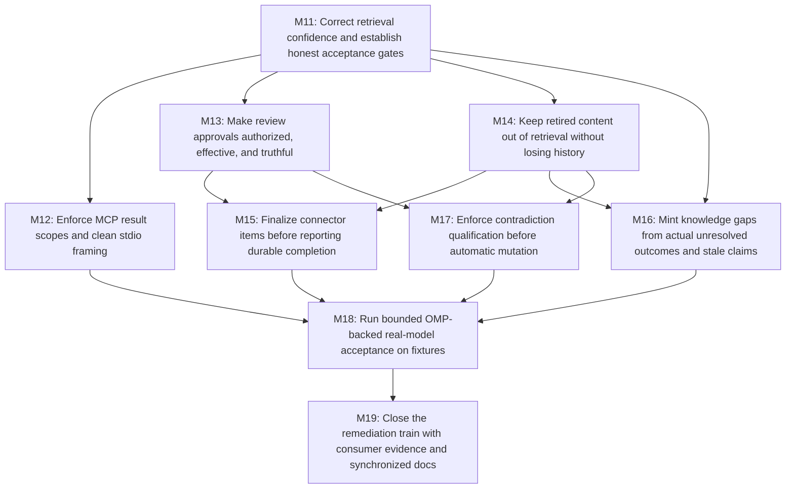

# Development Plan — VaultMind Acceptance and Integration Remediation

Plan ID: `VM-REMEDIATION-2026-10-11-R1`. Prepared: `2026-10-11T20:21:02Z`. Initial preparation status: ready for runner bootstrap and design gates; product milestones initially pending. Derive current execution state from external evidence and the canonical ledger. Repository: `/Users/druk/WorkSpace/AetherForge/VaultMind` (`Mathews-Tom/VaultMind`).

## 1. Context & Source Map

This fresh plan replaces the prior M1–M10 delivery plan, prompts and local ledger at the user's request. Those features are already merged; this train repairs the confirmed acceptance/integration defects and closes evidence gaps rather than rebuilding them. Primary requirements are the current audit and the user's explicit automation/storage/OMP decisions, grounded in the code and merged PRs at `83076de98d43e0176004c75ce346afc3e387a417`. The fresh history preserves a baseline summary; old DESIGN GO or merge records do not authorize new work.

| Finding | Requirement and evidence | Source reference (baseline snapshot; revalidate before edits) | Milestones |
| --- | --- | --- | --- |
| G01 | RRF pseudo-distance misclassifies exact matches; rank/confidence must be separated. | `src/vaultmind/indexer/store.py:260–299; indexer/ranking.py:331–387; bench/runner.py:76–117; bot/handlers/recall.py:141–159` | M11 |
| G02 | Restricted traversal leaks private metadata; MCP CLI diagnostics pollute protocol stdout. | `src/vaultmind/mcp/server.py:423–453,627–679; mcp/auth.py:71–99; cli.py:1718–1781; actual restricted-profile stdio probe` | M12 |
| G03 | Callback allowlist is absent; bot tag appliers are missing; operational failure is recorded as rejection; BLOCK delivery is incomplete. | `src/vaultmind/bot/handlers/autonomy.py:36–147; cli.py:615–619,715–732,1216–1236; bot/handlers/delete.py:88–124; bot/handlers/edit.py:148–207; services/review_queue.py:334–365,440–463` | M13 |
| G04 | Full/watch reindex resurrects soft-deleted content; preserved edit history is indexed; embedding failure removes the last good note. | `src/vaultmind/indexer/store.py:55–141; contradiction/marking.py:38–88; bot/handlers/{delete,edit}.py; vault/watch_handler.py; actual Chroma lifecycle probes` | M14 |
| G05 | Delayed source approval skips explicit finalization; source status and cursor can overstate completion. | `src/vaultmind/cli.py:715–732; bot/handlers/autonomy.py:102–115; sources/pipeline.py:140–252,265–345; services/review_queue.py:440–463` | M15 |
| G06 | Weak retrieval is not equivalent to an uncited decline; stale-claim gap kind has no production minting site. | `src/vaultmind/bot/thinking.py:148–203,209–290; memory/gaps.py:26–31; graph/evolution.py:282–294; services/loops/evolution_loop.py:16–73; bot/handlers/evolve.py:38,87; mcp/server.py:924` | M16 |
| G07 | Eval output does not enforce auto_resolve safety; starter corpus and provider errors are not production qualification. | `src/vaultmind/contradiction/detector.py:127–146; cli.py:2083–2136; benchmarks/contradict_eval.yaml:1–20; prior M6 ledger caveat summarized in fresh history` | M17 |
| G08 | Mandatory legacy live checks were not successful; user prefers omp -p rather than new dedicated API credentials. | `Prior M6/M8 credential caveats; user authorization in fresh history; installed omp 18.9.1 help and actual LOCAL_STUB_ONLY headless probe` | M18 |
| G09 | Old plan/prompt assumptions drifted and review gates were not evidenced; closure needs synchronized contracts and actual consumer evidence. | `Superseded M2 revision/human-gate history summarized in fresh history; .github/workflows/ci.yml:1–44; pyproject.toml:5–82; merged PRs #52–#85; current user automation/storage decisions` | M11, M19 |

## 2. Assumptions & Gaps

> ASSUMPTION: Automatic merges and versioned plan/prompt bootstrap are explicitly user-approved. Independent agent review plus green acceptance/CI is the routine merge gate; GitHub-required human approval remains binding.

> ASSUMPTION: OMP is the preferred implementation and model-validation vehicle. The installed CLI is 18.9.1; a single localhost-only stub request verified headless JSONL and zero advertised tools. No hosted model was called during planning. Native SDK credentials/embedding behavior were not qualified by that rehearsal.

> ASSUMPTION: The repository keeps version 0.1.0 and no publication is requested. This is an unversioned remediation train, not a new release policy.

> ASSUMPTION: M11–M19 are fresh IDs so legacy M1–M10 records cannot be mistaken for new completion. STACK_DEPTH_HINT is 6; each implementation stack has one or two PRs, excluding the once-only bootstrap or conditional reconciliation PR.

> ASSUMPTION: The audit's broader configuration precedence, unrelated MCP introspection wiring, dormant caches/health utilities and research-feature ideas are deferred. They are not hidden acceptance conditions for this fixture-scoped remediation train. Use explicit isolated TOML configuration so the known precedence defect cannot redirect validation into user state.

No unresolved design GAP blocks authoring. Runtime blockers are conditional and must be reported as NO-GO, never rewritten as assumptions: unavailable OMP auth/model, mandatory GitHub approval/permissions, unrelated dirty state, invalid current receipts, or failed CI/acceptance. Native API/production qualification remains explicitly unclaimed, not an omitted check.

### Runner authorization and safety profile

The user authorized automatic root-to-leaf merges after independent per-PR and whole-stack agent review, successful local acceptance and fresh green CI. This explicit profile replaces the generic plan-prompts human-merge handoff and the superseded plan's blanket human-premerge gates for fixture-only remediation. It never authorizes author self-approval, bypassing branch protection, disabling required checks, or claiming old PRs had a human review. Request a real human review when GitHub policy requires it; stop with NO-GO if that gate cannot be satisfied. Do not summon external reviewer bots or tag reviewers to spend review quota; address reviews that arrive automatically.

Use milestone-runner for orchestration, stacked-prs for topology and merge hygiene, and independent omp -p implementation sessions as the user-preferred replacement for the runner's default claude -p vehicle. Default to sequential M11 through M19 because the fixes share cli.py, store.py, thinking.py, review_queue.py and the verification script. Only independent evidence/review lanes run concurrently. Use absolute worktree paths; the canonical runner alone decides gates, writes the history/contracts, merges, rebases, retargets and cleans branches. An implementation lane may create/push its assigned branches and open its stack PRs with explicit bases; it never writes contracts/history, makes canonical gate decisions, retargets/rebases/merges or cleans branches. It returns IMPLEMENTATION COMPLETE — READY FOR INDEPENDENT GATES with PR/CI/command evidence, or an explicit IMPLEMENTATION BLOCKED reason. The canonical runner then dispatches independent verification and per-PR/whole-stack review and alone issues the release-aware GO/NO-GO. This two-stage handoff explicitly replaces treating an unreviewed worker terminal status as the runner Stack-verdict gate; missing independent review is pending canonical work, not a fabricated worker GO. Fixable independent review, verification or CI findings return to the same implementation worktree/worker with exact evidence; canonical dispatches a follow-up worker when the original session ended. Workers change product code and push their own assigned branches only. Canonical owns any necessary rebase/retarget, reruns affected offline gates, obtains fresh independent review and current-head CI, and repeats until satisfied. Missing/pending review is active canonical work, not a human blocker. Material scope changes first reconcile both contracts; GitHub-required human approval, inaccessible prerequisites, production/native-spend requests and exhausted/failed hosted campaigns remain genuine NO-GO gates. Never retry the hosted campaign during this loop without explicit recovery authorization.

A typical implementation launch is `omp -p --mode json --auto-approve --max-time 1h --cwd <absolute-worktree> @<absolute-rendered-prompt-file>`. Do not use the interactive-only --goal flag in headless mode. Reuse existing authenticated model configuration, or pass an explicitly verified available model; never create an empty isolated profile that silently changes models. Retain terminal JSONL/error evidence; exit 0 alone is not completion. Verification-only model calls use the stricter M18 tool-free policy, not this implementation command.

Routine fixture checks need no human confirmation. All mutable application state belongs in a newly created temporary HOME/vault/index/database/graph directory with an explicit temporary TOML config; verification evidence uses the separately declared receipt roots; do not rely on environment overrides that the existing Settings.from_toml precedence bug can ignore. No real vault edits/deletes/reindex, production cursor replay, queue migration on live data, Telegram sends to real chats, credential rotation/configuration change, tag/release/publication, or new dedicated SDK/embedding spend is authorized. Any such action needs separate human authorization and does not block independently runnable fixture remediation. Stop rather than weaken a required check or hide a failure.

The user prefers omp -p for real-model fixture validation using its existing authentication. This is not a promise of free calls or native SDK/embedding authentication. Native-provider calls have no approved dollar budget; do not fall back to them silently. Production auto-resolution stays false and requires separately eligible native-runtime evidence before it may be enabled. M18 is genuine model-backed fixture verification, explicitly not private-vault or native-provider qualification.

### Versioned-contract bootstrap (before M11)

These files are prepared locally by this planning task; no commit, branch or PR is created now. The user approved tracking DEVELOPMENT_PLAN.md and EXECUTION_PROMPTS.md during execution, superseding the prior local-only convention. The existing global .docs/ ignore rule remains; DEVELOPMENT_PLAN_HISTORY.md stays ignored and must never be force-added.

At first execution, inspect clean canonical state and existing remote/rules/checks using explicit repository Mathews-Tom/VaultMind. If the two contracts are not already tracked and merged with the exact intended contents, the canonical runner opens a standalone `docs(plan): establish vaultmind remediation contracts` PR containing only the two contracts. Because ignored files are absent in a new worktree, explicitly transfer these exact two snapshots from the canonical checkout into the docs worktree, then `git add -f -- .docs/DEVELOPMENT_PLAN.md .docs/EXECUTION_PROMPTS.md`; never stage the directory or the history. Independently verify their coverage/DAG/contract synchronization and get current repository CI green, review, merge, update canonical main, then rerun M11's design gate. Existing whole-repository lint/format drift is recorded for M11; bootstrap is a docs-only gate using artifact checks and existing CI, not a claim that the repaired full-scope quality gate already passes.

This bootstrap is a once-only precondition, not a product milestone and not part of Est. PRs. Subsequent material revisions use normal docs-only reconciliation PRs. All implementation worktrees must see the current committed contracts, not a copied stale .docs snapshot.

## 3. Dependency Graph

## 4. Release Trains

| Target release | Included milestones | Preparation trigger | Required artifacts | Verification | Publication |
| --- | --- | --- | --- | --- | --- |
| `unversioned` | `M11,M12,M13,M14,M15,M16,M17,M18,M19` | All included milestones are externally merged. | `none` | `uv run vaultmind --version` reports `0.1.0` after final merge. | not requested |

Release preparation is assigned once to final closeout after M19 merges. Because required artifacts are none, report RELEASE PREP: not-required throughout; the final version check is acceptance, not a version-bump/release action. Do not invent a changelog, tag or package publication.

## 5. Plan Evolution Protocol

- Before bootstrap these are local prepared snapshots. After bootstrap the two committed contracts plus current code, merged PRs and CI are authoritative. The ignored history is reconstructible evidence only, with exactly one canonical writer.
- Before each milestone read its current plan row, entire prompt, source-map findings, canonical history, current code, merged predecessor diffs/PR outcomes/checks, and predecessor acceptance receipts. Recheck load-bearing citations; this baseline's line numbers are not immutable.
- Record exactly one design verdict: DESIGN GO — PLAN REVISION: none; DESIGN GO — PLAN REVISION: <entry IDs>; or DESIGN NO-GO — REASON: <blocking evidence>. No product branch, edit or implementation PR before a current unchanged DESIGN GO.
- Material mismatches update the current and every directly/transitively affected future milestone in BOTH contracts; recompute DAG, order, PR counts, acceptance, verification and release membership together. Open a scope-clean docs-only `docs(plan): reconcile M# design` prerequisite PR, reviewed/green/merged before product work; then reload and rerun the affected design gates. History cannot override an unreconciled contract.
- A DESIGN NO-GO blocks only its affected dependency closure. Continue a genuinely independent ready milestone after its own current gate; never advance a dependent or continue a lane using an invalidated shared assumption. Record exact remediation and next runnable milestone under the literal NEXT STEPS: heading.
- The canonical runner externally verifies lane claims through an independent verifier and independent per-PR/whole-stack reviewers. It alone merges root-to-leaf, keeps parent branches until open children are safely retargeted, rebases after squash, verifies current-head CI after base changes, and cleans only verified merged branches. A child auto-closed by base deletion is not a merged milestone.
- Append design decisions and verified outcomes to the single ignored history: timestamp, artifact ID/digests and canonical HEAD, sources, decision, changed sections, affected dependents, authorization, PR URLs/bases/reviews/CI, exact commands/outcomes, receipt identity and unresolved gates. Never claim a test result from a predecessor as current verification.
- Before merging every docs or implementation PR, canonical posts a non-approving PR comment anchoring each independent per-PR/whole-stack review and verifier outcome to the reviewed head SHA, base, report SHA-256 and resolved findings. These external records make the ignored ledger reconstructible; they are not author self-approval or a substitute for required human approval.

### Verification and evidence contract

After M11, every milestone passes these gates in order: `uv run --extra dev --extra mcp ruff check .; uv run --extra dev --extra mcp ruff format --check .; uv run --extra dev --extra mcp mypy --strict src/ --ignore-missing-imports`; its targeted pytest command; its actual consumer smoke; full CI on Python 3.12/3.13. Validate each PR at its narrower scope and the complete milestone after the leaf, then rerun its offline/read-only verification on merged main. The M18 hosted campaign is the explicit exception: canonical runs it once on the reviewed CI-green leaf before GO/merge; subsequent gates validate the same receipts and offline paths, never launch another campaign. A formatter/linter rule suppression, changed threshold to fit the bug, skipped test or swallowed provider error is not a repair.

`scripts/verify_acceptance.py` is a proposed deliverable, not an existing command today. M11 adds a small retrieval-only case; M12–M17 add their respective real-surface cases; M18 adds all/qualification and the narrowly shared OMP adapter. Do not expose empty cases, no-op success, canned result echoes or a broad plug-in framework. Its offline case manifest is exactly retrieval, mcp, approval, lineage, sources, gaps, contradiction. Each case must mutate/exercise the named real consumer and assert the substantive state/output invariant. Use temporary fixture data, real Chroma/BM25/parser/SQLite/event bus and actual stdio/CLI/handler surfaces; deterministic embeddings, scripted LLMClient completions at the llm.client boundary, and fake network delivery are explicitly labeled boundary substitutes. Scripted completions supply valid/invalid response-boundary inputs while the actual pipeline/storage/effects are exercised; they cannot count as model-quality or live-provider evidence. These substitutes are not evidence about hosted embedding quality or Telegram delivery. Production configuration provider values and factories stay unchanged. Offline CLI cases inject deterministic embeddings and scripted LLMClient objects only within an explicitly labeled in-process verification seam around the actual Click entrypoint; temporary non-secret sentinel credentials may satisfy existing key boundaries, but no shipped key check is removed or bypassed. Never add an offline or OMP Settings provider value. Any subprocess CLI resolves from the running interpreter environment, never an unqualified PATH/uv run; record its installed package import origin and remove inherited PYTHONPATH/source-tree overrides. Verification-time injection is not production provider evidence.

Commands using the proposed script execute only after their owning milestone implements them. Every receipt records artifact revision, relevant code/corpus identities, command, expected and actual outcomes, transport, provider/model when used, and failure details. Disposable offline receipts may use /tmp. The single M18 qualification bundle uses the durable ignored canonical root <absolute-canonical-repo>/.docs/.receipts/<PlanID>, outside disposable implementation worktrees; this fixture-only local root is authorized by the launch prompt. Never commit receipt files or personal data. A receipt directory is newly allocated per run; do not mix old files with current success. CI runs offline scenarios only. Model cost fields are modeled prices, never provider billing evidence.

M18 freezes exactly 30 synthetic contradiction pairs, three source/distillation items, and the three A1–A3 thinking trials specified in its Acceptance before calling a model: 36 primary hosted trials. Freeze the full completion-call manifest as well; any required auxiliary completion must be identified before the campaign, count against the same 40-hosted-process limit, and be labeled separately. No unregistered or hidden side completion is allowed; disable only optional features explicitly outside the fixture qualification scope, never a required consumer. Only the canonical runner starts its one hosted campaign, after the implementation worker returns and independent code/offline/CI gates pass, on the reviewed leaf worktree before GO/merge. The worker implements/tests the adapter but makes no hosted trials. Canonical first runs --transport local-stub --max-local-processes 8 --receipt-root <absolute-canonical-repo>/.docs/.receipts/<PlanID> to allocate a fresh unique bundle and record the local rehearsal, with a 20-minute rehearsal deadline. Only after every expected guard outcome passes, run --transport omp --max-model-calls 40 --receipt-dir <emitted-rehearsal-directory> to append the one hosted phase to that same new bundle. Hosted mode refuses a bundle with any previous hosted-phase start; replay mode is read-only and requires both phases. The hosted phase has a separate 90-minute deadline; rehearsal plus hosted validation is bounded by 110 minutes, outside the one-hour implementation-worker deadline. Before GO, canonical records the emitted directory in local history and posts the canonical-repo-relative receipt locator, manifest SHA-256, scoped outcome and relevant code/corpus identities in the M18 PR body/comment without secrets or raw private output; a rebuilt history can recover this durable locator. Independent and post-merge verification invoke --case qualification --verify-receipts <that-recorded-directory> plus offline consumers; they do not run --transport omp again. On a partial/failed campaign stop for explicit recovery authorization, with prior process usage accounted; a new process counter is not renewed authorization. At most 40 hosted OMP child processes are allowed across that milestone; separately permit at most 8 localhost-only rehearsal processes, with isolated keyless model configuration and no hosted endpoint; one fixed trial per process, 16000 input characters maximum and 120 seconds per child with process-group termination. No model shopping, automatic retry campaign, title/summarization/advisor side calls, tool execution or private note input. Revalidate actual OMP controls and rehearse against a local stub before hosted calls. Missing terminal output, error stop reasons, canceled/timed-out processes, unexpected tool activity, malformed answer JSON, absent usage or mismatched actual identity are failures even when the process exits 0. The local rehearsal proved this transport shape only; it is never a live trial.

A valid detector loss is legitimate AUTO-RESOLVE NO-GO evidence, not a reason to tune labels or rerun until it wins. It can satisfy fixture-scoped safety verification if every planned prediction is valid and automatic mutation stays denied. Infrastructure/partial results cannot satisfy M18. OMP-backed receipts cannot unlock the native-runtime gate in M17. If native SDK or hosted embedding qualification is later requested, declare its provider/model/corpus/endpoint and obtain credentials and an explicit spend cap before any call; that is a separate gate, not silently added scope.

#### R1-A design reconciliation — durable gates and positive qualification

Revision ID: `R1-A`. Bootstrap review identified evidence-reconstruction and qualification guard gaps. This revision applies to the shared merge/evidence rules for M11–M19 and adds the following acceptance requirements to M17/M18 and their M19 read-only consumers. Dependencies, release membership, PR counts and verification commands are unchanged. Product implementation requires this docs-only reconciliation to be independently reviewed, CI-green and externally merged.

- M17 additional acceptance: Inside isolated temporary fixtures, a test-built native-identity receipt satisfying every eligibility condition, with an explicitly approved fixture corpus digest and matching fixture vault-scope identity, passes both qualification checks and permits the actual marking operation. Mutating any single bound eligibility field denies marking and preserves original bytes. This is boundary-test evidence using the explicitly labeled scripted LLMClient seam, not native-model qualification; no production approval or auto-resolution setting is changed.
- M18 additional acceptance: Persist a PlanID-wide campaign-start identity atomically before starting the first hosted child, and persist process reservations before spawning children. Both fresh-bundle allocation and hosted-phase start inspect the entire durable PlanID receipt root and refuse another campaign after any hosted start, including an incomplete prior bundle. The 40 hosted-process cap is cumulative across bundles; explicit recovery authorization is required after partial failure and cannot reset consumed reservations. Anchor the fresh rehearsal locator and frozen manifest digest in M18 PR evidence before hosted start, then anchor the final manifest digest and scoped outcome before GO. Read-only verification checks these identities and cumulative accounting without spawning OMP.

## 6. Sections & Milestones

### Section A — Retrieval and access correctness

#### M11 — Correct retrieval confidence and establish honest acceptance gates

| Field | Value |
| --- | --- |
| Objective | Strong retrieval is not misclassified as weak because fusion rank was treated as vector distance; recall, authority ranking, and the benchmark use one explicit confidence contract. |
| In / Out of scope | In: raw vector-distance preservation, RRF/authority ranking separation, strong/weak/unknown relevance semantics, every confidence consumer and fixture schema, a real Chroma/BM25 retrieval smoke, and the recorded lint/format/CI prerequisites. Out: changing RRF weights, wiring the unused composite-ranking pipeline, calibrating a new relevance model, or claiming retrieval-quality gains from canned results. |
| Depends on | none |
| Target release | unversioned |
| Source map | G01, G09 |
| Deliverables | Rank score is explicitly distinct from raw relevance evidence; lexical-only hits have explicit unknown confidence, not fabricated vector distance. Migrate all callers and fixtures together. Add the retrieval case to the small verification script. Fix only the recorded baseline lint/format blockers in tests/test_bm25.py, tests/test_inbox_triage.py, tests/test_mcp_capture_note.py, and tests/test_autonomy.py. CI installs dev+mcp extras, checks repository-wide lint/format and strict source types, runs the full suite on Python 3.12/3.13, and triggers for all PR bases plus base-edited events. |
| Acceptance | A deterministic exact self-match through real Chroma/BM25 is strong in vector and hybrid modes; empty retrieval is weak; a lexical-only result with no vector evidence is unknown and cannot score a correct deterministic decline merely because its RRF score is small. Unknown confidence never mints a weak_retrieval gap and is reported as unknown; only explicitly weak retrieval mints that gap. Authority can reorder otherwise comparable results without altering confidence. Recall and bench agree on the same result set and threshold boundary. Seven previously recorded lint findings and the recorded formatting failure are corrected without disabling rules. Child PRs and retargeted PRs get fresh CI. |
| Verification | uv run --extra dev --extra mcp ruff check .; uv run --extra dev --extra mcp ruff format --check .; uv run --extra dev --extra mcp mypy --strict src/ --ignore-missing-imports; uv run --extra dev --extra mcp pytest tests/bench/ tests/test_gaps.py tests/test_ranking.py tests/test_composite_ranking.py tests/test_hybrid.py tests/test_bm25.py -q; uv run --extra dev --extra mcp python scripts/verify_acceptance.py --case retrieval --offline. Every listed command must meet the stated acceptance; CLI smokes emit machine-readable per-case outcomes and exit nonzero on failure. |
| Design reevaluation | Enumerate every distance/rrf_score/score_floor consumer and verify current fixture schemas and CI triggers. Preserve observable ranking unless a separate source-backed revision is agreed. Direct dependents M12, M13, M14, M16; transitive dependents M15, M17, M18, M19. |
| Risks & rollback | Do not retune score_floor to fit RRF units. Changes to result shape require a clean caller/fixture cutover. Revert the whole milestone stack on contract regression; never silently restore pseudo-distance semantics. |
| Est. PRs | 2 |
| Implementation targets | src/vaultmind/indexer/{store,hybrid,ranking}.py; src/vaultmind/bench/{runner,fixture_store}.py; src/vaultmind/bot/{thinking,handlers/recall}.py; tests/bench/; tests/test_gaps.py; .github/workflows/ci.yml; scripts/verify_acceptance.py (new); README.md; docs/architecture.md |

#### M12 — Enforce MCP result scopes and clean stdio framing

| Field | Value |
| --- | --- |
| Objective | Restricted MCP clients cannot discover out-of-scope note metadata through traversal, and the real stdio entrypoint emits only MCP protocol frames on stdout. |
| In / Out of scope | In: per-result scope filtering, omitted/empty/root folder handling, outgoing/backlink filtering and counts, symlink containment, startup/logging streams, and actual subprocess MCP verification. Out: new MCP tools, unrelated introspection collaborator wiring, changing unrestricted-profile semantics, or enabling write access. |
| Depends on | M11 |
| Target release | unversioned |
| Source map | G02 |
| Deliverables | Reuse ProfileEnforcer for every returned path. For a restricted profile, omitted/empty/root folder input is a virtual aggregate of allowed roots only; an explicit forbidden folder is denied. Do not reveal restricted targets as unresolved link titles. Recompute counts after filtering. Send MCP startup diagnostics and logs to stderr. Add the mcp case to the verification script. Add a real subprocess stdio regression to tests/test_mcp_traversal.py, included in full CI with mcp installed; require zero protocol parse errors and actual scoped results. |
| Acceptance | Actual MCP stdio initialize/list_tools/read_frontmatter/list_folder_index/follow_links calls succeed on an isolated vault. Under planner scope, an allowed hub linked both ways to a private note returns neither the private title, path, description, nor its contribution to counts. Omitted, empty, explicit root, nested and symlink cases obey the same policy. Forbidden input is denied and read_frontmatter never returns body text. Researcher/full access remains unchanged. Every stdout line is a valid protocol frame; the client sees zero protocol parse errors. |
| Verification | uv run --extra dev --extra mcp ruff check .; uv run --extra dev --extra mcp ruff format --check .; uv run --extra dev --extra mcp mypy --strict src/ --ignore-missing-imports; uv run --extra dev --extra mcp pytest tests/test_mcp_traversal.py tests/test_mcp_auth.py tests/test_mcp_capture_note.py -q; uv run --extra dev --extra mcp python scripts/verify_acceptance.py --case mcp --offline. Every listed command must meet the stated acceptance; CLI smokes emit machine-readable per-case outcomes and exit nonzero on failure. |
| Design reevaluation | Inspect configured profiles as well as built-ins, real stdio/logging startup, symlink resolution and result counts. Resolve field-scope behavior using the stated virtual-root rule, not a silent broadening of permissions. Direct dependent M18; transitive M19. |
| Risks & rollback | A missing result-level enforcer must fail closed for scoped tools. Do not broaden planner permissions to make tests pass. Revert the milestone PR if protocol or access behavior regresses. |
| Est. PRs | 1 |
| Implementation targets | src/vaultmind/mcp/{server,auth,profiles}.py; src/vaultmind/cli.py::mcp_serve and logging setup; tests/test_mcp_traversal.py; tests/test_mcp_auth.py; scripts/verify_acceptance.py; docs/mcp-integration.md |

### Section B — Safe approvals and current-content lifecycle

#### M13 — Make review approvals authorized, effective, and truthful

| Field | Value |
| --- | --- |
| Objective | Only authorized Telegram actors can resolve proposals; approved mutation proposals apply their real operation, and BLOCK proposals reach the configured review surface without false success. |
| In / Out of scope | In: authorization on actual autonomy approve/reject/approve-all and delete/edit confirm/cancel callbacks, shared CLI/bot tag appliers, missing-applier behavior, truthful application errors, BLOCK notifications for existing proposal producers, and meaningful approve-all results. Out: generalized retries, a new approval framework, changing the documented empty-allowlist policy, or source finalization itself (M15). |
| Depends on | M11 |
| Target release | unversioned |
| Source map | G03 |
| Deliverables | Use the existing authorization rule before reading/resolving callback proposals. Share actual tag-application and tag-vocabulary appliers between auto-tag and bot assembly. Only explicitly informational kinds may ACKNOWLEDGE without an applier; mutation kinds must report a missing-applier error. Distinguish application failure from human rejection and preserve enough state for an authorized explicit retry. Generalize the current BLOCK notifier at existing producers, without performing Telegram I/O from SQLite transactions. Add the approval case. |
| Acceptance | An actor outside a configured allowlist cannot approve, reject, approve-all, confirm/cancel deletion, or confirm/cancel editing; edit callback payload ownership must match the authenticated actor before pending state is consumed; proposal state and vault bytes remain unchanged. An authorized bot approval of a CLI-created TAG_APPLICATION/TAG_VOCABULARY proposal changes actual frontmatter/vocabulary, records the correct terminal status, and a replay does not repeat the mutation. Missing appliers and raised operations never report Applied/Approved or Human Rejected. Informational acknowledgement remains explicit. Each newly pending BLOCK proposal on an enabled bot notification path emits one approval keyboard and stays unapplied; disabled/unavailable notification delivery is reported honestly. Approve-all reports applied/acknowledged/failed outcomes rather than counting failed operations as success. |
| Verification | uv run --extra dev --extra mcp ruff check .; uv run --extra dev --extra mcp ruff format --check .; uv run --extra dev --extra mcp mypy --strict src/ --ignore-missing-imports; uv run --extra dev --extra mcp pytest tests/test_autonomy.py tests/test_delete_handler.py tests/test_edit_handler.py tests/test_review_queue.py tests/test_review_command.py tests/test_contradiction_escalation.py -q; uv run --extra dev --extra mcp python scripts/verify_acceptance.py --case approval --offline. Every listed command must meet the stated acceptance; CLI smokes emit machine-readable per-case outcomes and exit nonzero on failure. |
| Design reevaluation | Enumerate all current mutation/informational proposal kinds, producer notification paths, existing callback guards, and CLI/bot applier construction. Preserve existing queue rows with a deterministic schema/status migration if needed. Direct dependents M15, M17; transitive M18, M19. |
| Risks & rollback | No author self-approval or GitHub policy bypass is permitted. SQLite migration must preserve original proposals and distinguish user rejection from operational failure. Revert the stack with its documented additive migration handling; never mutate production queue data during verification. |
| Est. PRs | 2 |
| Implementation targets | src/vaultmind/services/review_queue.py; src/vaultmind/bot/{commands,telegram}.py; src/vaultmind/bot/handlers/{autonomy,delete,edit,utils,review}.py; src/vaultmind/cli.py; existing tag vocabulary/frontmatter helpers; tests/test_autonomy.py; tests/test_review_queue.py; scripts/verify_acceptance.py; docs/telegram-bot.md; tests/test_delete_handler.py; tests/test_edit_handler.py |

#### M14 — Keep retired content out of retrieval without losing history

| Field | Value |
| --- | --- |
| Objective | Soft-deleted notes and superseded edit bodies stay preserved on disk but cannot return as current evidence after incremental indexing, watcher updates, or a full reindex. |
| In / Out of scope | In: an explicit active-content projection for bot-generated supersede metadata/callouts, legacy generated markers, Chroma/BM25 retirement and reconciliation, safe embedding-before-replacement, watcher integration, and original-text/lineage preservation. Out: hard deletion, full claim-layer modeling, graph-history UI, suppressing ordinary authored callouts, or automatic production reindex/migration. |
| Depends on | M11 |
| Target release | unversioned |
| Source map | G04 |
| Deliverables | One shared projection defines indexable current content; full note reads still preserve history. Bot:delete notes remove current vector and keyword rows even when indexing yields no chunks. Bot edits index only the current revision, not preserved prior claims. Full reindex removes stale rows absent from the supplied canonical snapshot, including an empty vault. Compute embeddings before destructive replacement; report cross-index failures explicitly instead of success. Add the lineage case, including real watcher-event handling. |
| Acceptance | Delete then full reindex and delete then watch/incremental indexing return no retired text in vector, keyword or hybrid search while the original file/body and one lineage edge remain. Two successive edits keep all original text/history but only the latest claim is retrieved as current evidence. Actual file removal followed by full reindex removes stale rows; an empty full-index snapshot clears only derived indexes. Injected embedding failure preserves the last good searchable note. Ordinary superseded-looking author text is not blindly truncated. Already-generated legacy markers are handled explicitly; ambiguous history boundaries fail/report without rewriting original text. |
| Verification | uv run --extra dev --extra mcp ruff check .; uv run --extra dev --extra mcp ruff format --check .; uv run --extra dev --extra mcp mypy --strict src/ --ignore-missing-imports; uv run --extra dev --extra mcp pytest tests/test_delete_handler.py tests/test_edit_handler.py tests/test_watch_handler.py tests/test_contradiction_marking.py tests/test_evolution.py tests/test_bm25.py -q; uv run --extra dev --extra mcp python scripts/verify_acceptance.py --case lineage --offline. Every listed command must meet the stated acceptance; CLI smokes emit machine-readable per-case outcomes and exit nonzero on failure. |
| Design reevaluation | Inspect generated bot:delete/edit markers and chunk boundaries, every full/incremental index caller, keyword/vector deletion ordering, and existing preserved notes in synthetic fixtures. Never inspect private note bodies to invent migration rules. Direct dependents M15, M16, M17; transitive M18, M19. |
| Risks & rollback | Derived-index reconciliation is destructive only inside isolated fixtures for this train. No live vault mutation is authorized. Preserve canonical markdown/lineage on every failure; revert code and rebuild only a separately authorized derived index if necessary. |
| Est. PRs | 1 |
| Implementation targets | src/vaultmind/vault/{models,parser,watch_handler}.py; src/vaultmind/indexer/{store,bm25}.py; src/vaultmind/contradiction/marking.py; src/vaultmind/bot/handlers/{delete,edit}.py; tests/test_delete_handler.py; tests/test_edit_handler.py; tests/test_watch_handler.py; tests/test_contradiction_marking.py; scripts/verify_acceptance.py; docs/architecture.md |

### Section C — Complete ingestion and gap semantics

#### M15 — Finalize connector items before reporting durable completion

| Field | Value |
| --- | --- |
| Objective | AUTO and later-approved connector items complete the same write/index/event pipeline, and failures remain recoverable instead of being hidden behind Applied status or an advanced cursor. |
| In / Out of scope | In: source write/finalization lifecycle, complete bot collaborator assembly, durable item/proposal identity, cursor-versus-pending semantics, explicit failure/recovery, all three connector reruns, and source CLI exit/run-summary behavior. Out: new connectors, queue bypass, generalized retry/backoff, scheduler redesign, or resetting production cursors. |
| Depends on | M13, M14 |
| Target release | unversioned |
| Source map | G05 |
| Deliverables | Thread the live event bus and all finalization collaborators into bot handlers. Record source completion only after note parsing, indexing and event dispatch succeed. Persist pending input/proposal/item identity before any cursor advancement; advancing over a durable pending snapshot is allowed, dropping an unpersisted failed item is not. Preserve approval decisions and failure details for explicit recovery. Reuse one finalization path for AUTO/approve/approve-all/CLI/scheduler and idempotent source note identity. Add the sources case with actual CLI entrypoint invocation. |
| Acceptance | For each RSS, YouTube-channel and GitHub-activity fixture, successful ingestion and a second run produce no duplicate item/note. AUTO and approved SKIM/BLOCK paths create authority=1 provenance notes searchable immediately and dispatch the dedup/contradiction event path. Repeated approval/rerun does not duplicate notes, lineage or proposal effects. A write/index/dispatch failure is not Applied/ingested success and is recoverable after reopening SQLite stores; no fetched item disappears merely because the cursor advanced. A durable pending snapshot may legitimately outlive its source cursor. Actual source CLI exits 0 for complete fixture ingestion and nonzero for operational failure, with truthful fetched/pending/ingested/failed summaries. |
| Verification | uv run --extra dev --extra mcp ruff check .; uv run --extra dev --extra mcp ruff format --check .; uv run --extra dev --extra mcp mypy --strict src/ --ignore-missing-imports; uv run --extra dev --extra mcp pytest tests/sources/ tests/test_autonomy.py tests/test_review_queue.py -q; uv run --extra dev --extra mcp python scripts/verify_acceptance.py --case sources --offline. Every listed command must meet the stated acceptance; CLI smokes emit machine-readable per-case outcomes and exit nonzero on failure. |
| Design reevaluation | Verify latest M13 queue status semantics and M14 index replacement guarantees; map source file-write/index/event/status/cursor ordering in every assembly path. Event bus handlers are not a cross-database exactly-once transaction: use stable identities and idempotent consumer effects; do not promise exactly-once dispatch across crashes. Direct dependent M18; transitive M19. |
| Risks & rollback | Treat any needed SQLite migration as additive and test reopen/upgrade on copies. Do not rewind real cursors, replay real feeds, or discard queued items. Explicit recovery is item-scoped, not a new retry daemon. Revert both stack PRs together if the lifecycle contract changes. |
| Est. PRs | 2 |
| Implementation targets | src/vaultmind/sources/{pipeline,store,cursor}.py; src/vaultmind/services/review_queue.py; src/vaultmind/cli.py::bot and source_run; src/vaultmind/bot/{commands,handlers/autonomy}.py; tests/sources/; tests/test_autonomy.py; scripts/verify_acceptance.py; docs/telegram-bot.md; docs/configuration.md |

#### M16 — Mint knowledge gaps from actual unresolved outcomes and stale claims

| Field | Value |
| --- | --- |
| Objective | The gap ledger records an actual uncited decline or unresolved artifact and actual stale-claim signals, without treating low retrieval confidence as proof that an answer declined. |
| In / Out of scope | In: typed answer-status/citation metadata from the same thinking response, post-response minting, stale-claim minting through real evolution scan entrypoints, stable dedup identity/evidence, and existing gap lifecycle. Out: another LLM classifier call, free-form refusal regexes, changing all thinking retrieval/ranking, new research providers, or automatic claim mutation. |
| Depends on | M11, M14 |
| Target release | unversioned |
| Source map | G06 |
| Deliverables | Replace the pre-answer weak-context proxy with answer_status restricted to answered or declined, plus a citations list of verified current vault references produced in the existing completion. Strip metadata from user-visible text, validate it at the response boundary, and report malformed status instead of guessing. Keep /recall weak-retrieval gaps on M11 semantics. Connect stale-claim signals to GapStore through one shared runtime path used by real callers; pure detector scans and read-only MCP graph_evolution remain read-only; minting is owned by bot/scheduled evolution orchestrators, not a read-only MCP call. Add the gaps case. Both bot evolution and scheduled evolution must invoke scan_with_file_ages with current-note mtimes and the shared GapStore minting path; wire these inputs in cli.py::bot, rather than proving the stale detector only through a direct test call. |
| Acceptance | A strong retrieval followed by an actual uncited decline mints one unanswered gap; an answered response does not mint one merely because retrieval was weak. Empty-resolution distillation still mints one gap. Invalid response metadata is an explicit failure, not fabricated decline evidence; an invented citation is not accepted as a real vault citation. Repeating the same unresolved question or stale evolution signal deduplicates; stale-claim gaps carry actual source/entity evidence. Bot evolution and scheduled evolution use the shared minting path without duplicate implementations; read-only MCP evolution never writes the gap ledger. /gaps ordering, research closure and auto-stale behavior remain correct. One thinking turn still makes one answer completion, not a second classifier call. |
| Verification | uv run --extra dev --extra mcp ruff check .; uv run --extra dev --extra mcp ruff format --check .; uv run --extra dev --extra mcp mypy --strict src/ --ignore-missing-imports; uv run --extra dev --extra mcp pytest tests/test_gaps.py tests/test_thinking.py tests/test_evolution.py tests/test_loops.py tests/test_mcp_introspection.py -q; uv run --extra dev --extra mcp python scripts/verify_acceptance.py --case gaps --offline. Every listed command must meet the stated acceptance; CLI smokes emit machine-readable per-case outcomes and exit nonzero on failure. |
| Design reevaluation | Confirm M11 confidence semantics, M14 current-content projection, current extraction metadata conventions and all evolution scan entrypoints. MCP introspection wiring is deferred and read-only MCP calls must not acquire gap-minting side effects. Direct dependent M18; transitive M19. |
| Risks & rollback | Preserve existing gaps/dedup history and never reopen closed gaps as a side effect of a code migration. Metadata parse failures must be explicit. Revert the stack as a unit if answer/gap semantics regress. |
| Est. PRs | 2 |
| Implementation targets | src/vaultmind/bot/thinking.py; existing extraction/parser and thinking prompt definitions; src/vaultmind/memory/gaps.py; src/vaultmind/graph/evolution.py; src/vaultmind/services/loops/evolution_loop.py; src/vaultmind/bot/handlers/evolve.py; tests/test_gaps.py; tests/test_thinking.py; tests/test_evolution.py; tests/test_loops.py; scripts/verify_acceptance.py; docs/knowledge-graph.md; src/vaultmind/cli.py::bot (evolution_loop assembly) |

### Section D — Fail-closed qualification and real-model evidence

#### M17 — Enforce contradiction qualification before automatic mutation

| Field | Value |
| --- | --- |
| Objective | auto_resolve cannot authorize a note mutation without valid matching evaluation evidence; provider failures and fixture-only trials cannot become a passing runtime qualification. |
| In / Out of scope | In: strict eval outcomes, error-aware CLI exit/reporting, minimal qualification receipt and identity verification at mutation boundaries, safe default behavior, and gate-invalidation tests. Out: turning auto_resolve on by default, retuning labels to obtain a win, substituting Kosha results, a generalized benchmark service, or evaluating private notes without separate authorization. |
| Depends on | M13, M14 |
| Target release | unversioned |
| Source map | G07 |
| Deliverables | A small machine-readable eval/qualification receipt records pair identities and corpus digest/provenance, detector prompt/schema/code identity, requested and actual provider/model/transport, complete valid predictions, baseline/detector metrics, and eligibility scope. Failed/auth/malformed/partial evals cannot issue a passing receipt. A fixture or OMP-backed receipt is ineligible for native runtime auto-resolution. Validate matching eligible evidence when auto_resolve is requested and again at a mutation boundary; stale/missing evidence blocks mutation explicitly. Add the contradiction case. Approval is explicit: add ContradictionConfig.approved_corpus_digests as an empty-by-default list of approved SHA-256 corpus identities; runtime eligibility requires the digest in this list and receipt.runtime_scope_id matching the SHA-256 identity of the resolved canonical vault root. This train does not populate approval for production. A receipt cannot approve itself. |
| Acceptance | The actual eval path distinguishes a valid baseline loss from an infrastructure failure; neither enables automatic mutation. A missing, edited, stale or wrong-provider/model/transport/corpus receipt never permits marking even with auto_resolve=True. An eligible matching receipt must beat baseline on a corpus explicitly approved for its runtime scope, with zero missing/errored pairs; a synthetic starter set alone cannot qualify a private vault. auto_resolve=False stays the default and detected conflicts escalate without note mutation. Gate refusal is visible and preserves original note text, queue state and gap evidence. Unrelated docs-only commit changes do not invalidate evidence unnecessarily; detector/prompt/schema/model/corpus changes do. Both eligibility checks require the configured approved corpus digest and current vault-scope identity; the actual model reported by the detection response must match the qualified actual model before marking, even when a configured alias stays unchanged. |
| Verification | uv run --extra dev --extra mcp ruff check .; uv run --extra dev --extra mcp ruff format --check .; uv run --extra dev --extra mcp mypy --strict src/ --ignore-missing-imports; uv run --extra dev --extra mcp pytest tests/test_contradiction_detection.py tests/test_contradiction_policy.py tests/test_contradiction_marking.py tests/test_contradiction_escalation.py -q; uv run --extra dev --extra mcp python scripts/verify_acceptance.py --case contradiction --offline. Every listed command must meet the stated acceptance; CLI smokes emit machine-readable per-case outcomes and exit nonzero on failure. |
| Design reevaluation | Inspect current eval corpus template status, baseline arithmetic, per-pair errors and runtime client identity. Use relevant detector/protocol digests rather than requiring an unchanged repository HEAD. Decide the minimal receipt storage schema without secrets. Direct dependent M18; transitive M19. |
| Risks & rollback | Never enable auto-resolution on a real vault during this train. Missing evidence is a safety failure, not a reason to silently disable a requested setting. Revert code while retaining escalate-only operation; receipts tied to changed detector identity become ineligible. |
| Est. PRs | 1 |
| Implementation targets | src/vaultmind/contradiction/{detection,eval,detector,policy}.py; src/vaultmind/config.py::ContradictionConfig; src/vaultmind/cli.py::eval_contradict and bot startup; benchmarks/contradict_eval.yaml; tests/test_contradiction_detection.py; tests/test_contradiction_escalation.py; scripts/verify_acceptance.py; docs/configuration.md |

#### M18 — Run bounded OMP-backed real-model acceptance on fixtures

| Field | Value |
| --- | --- |
| Objective | The repaired pipelines have auditable real-model fixture evidence through omp -p without misrepresenting OMP authentication or deterministic embeddings as native API qualification. |
| In / Out of scope | In: a text-only verification adapter shared by contradiction, source/distillation and A1–A3 thinking scenarios, explicit OMP process isolation and terminal/error handling, frozen synthetic fixture trials, usage/identity receipts, actual assembled CLI/handler integration, and offline adapter guards in CI. Out: a new shipped llm.provider=omp backend, changing OMP account/settings, dedicated SDK calls without authorization, hosted embeddings, private-vault input, or repeated model-shopping campaigns. |
| Depends on | M12, M15, M16, M17 |
| Target release | unversioned |
| Source map | G08 |
| Deliverables | Add --case qualification --transport local-stub --max-local-processes 8 and --case qualification --transport omp --max-model-calls 40, a read-only --case qualification --verify-receipts <recorded-directory> mode, and --case all --offline to the verification command. --receipt-root <absolute-canonical-repo>/.docs/.receipts/<PlanID> allocates the fresh durable bundle for canonical local rehearsal and emits its absolute path; --receipt-dir <that-emitted-directory> permits one subsequent hosted phase only. Readonly validation never starts an OMP process and requires complete expected local-guard outcomes plus the hosted manifest. Canonical anchors the relative locator and manifest SHA-256 in M18 PR evidence before GO; raw receipts remain local/ignored. The live adapter maps the existing text completion contract to omp -p JSONL and is used by contradiction eval, source/distillation verification and the real ThinkingPartner A1–A3 answer/gap path. Keep production factories unchanged; explicitly label any verification-time client-factory injection. Record the actual model/provider/api, raw terminal events, fixture identities, argv without secrets, usage and expected/observed results. Local-stub transport checks are distinctly labeled and never counted as real-model trials. Add tests/test_verify_acceptance_omp.py and run it in the milestone targeted suite and full CI. Add a CI step executing --case all --offline so the complete seven-case real-surface matrix is not only a local smoke; CI must not invoke OMP or hosted APIs. |
| Acceptance | Before hosted trials, a local-stub rehearsal proves tool-free advertised requests, terminal JSON parsing, error/cancel/timeout handling and no execution of built-in/MCP tools. Real OMP runs complete the frozen 30-pair contradiction corpus plus three source/distillation items and the defined answer-status scenarios; every planned trial has a valid result or an explicit failure, with no hidden dropping or favorable replacements. Real source CLI/approval paths write provenance notes, index them using the explicitly labeled deterministic embedder, and run through the event bus; a second ingestion run is a no-op. Valid baseline losses record AUTO-RESOLVE NO-GO while leaving the product safely escalation-only; auth/transport/partial/invalid outputs fail milestone acceptance. Receipts say omp-fixture, deterministic-local embeddings, and native-provider NOT QUALIFIED. No new direct API credential is required for this scope, provided existing OMP auth works. The three frozen thinking trials are A1: answer a general-knowledge question with weak retrieval, answer_status=answered and citations=[], expected no unanswered gap; A2: strong retrieval but the requested fact is explicitly unavailable, answer_status=declined and citations=[], expected one deduplicated unanswered gap; A3: answer the fact in the provided current note, answer_status=answered and citations containing that exact resolvable vault reference, expected no unanswered gap. Invalid status or fabricated citations are negative offline response-boundary tests, not additional hosted trials; unexpected fabrication in any hosted trial fails qualification. |
| Verification | uv run --extra dev --extra mcp ruff check .; uv run --extra dev --extra mcp ruff format --check .; uv run --extra dev --extra mcp mypy --strict src/ --ignore-missing-imports; uv run --extra dev --extra mcp pytest tests/test_verify_acceptance_omp.py tests/bench/ tests/sources/ tests/test_autonomy.py tests/test_gaps.py tests/test_contradiction_detection.py tests/test_contradiction_escalation.py -q; uv run --extra dev --extra mcp python scripts/verify_acceptance.py --case all --offline; uv run --extra dev --extra mcp python scripts/verify_acceptance.py --case qualification --verify-receipts <canonical-recorded-M18-directory>. Canonical-only pre-merge local rehearsal, after independent offline/code/CI gates and the M19-declared fresh-wheel/offline-matrix subsection (not its receipt check): uv run --extra dev --extra mcp python scripts/verify_acceptance.py --case qualification --transport local-stub --max-local-processes 8 --receipt-root <absolute-canonical-repo>/.docs/.receipts/<PlanID>. Then the one hosted phase: uv run --extra dev --extra mcp python scripts/verify_acceptance.py --case qualification --transport omp --max-model-calls 40 --receipt-dir <emitted-rehearsal-directory>. The implementation worker never runs this hosted command. Independent/post-merge verification rechecks offline consumers and the same complete receipt set without more model calls. Every expected outcome must meet acceptance; failure exits nonzero. |
| Design reevaluation | Recheck installed omp --help and JSONL shape; pin the selected available authenticated model before freezing trials. Verify actual no-MCP discovery/approval controls from installed OMP, not guessed flags. No fresh isolated profile may silently pick a different model. Confirm all predecessor smokes and receipt identity rules. Direct dependent M19. Pin ThinkingPartner assembly for A1–A3. Disable optional graph-context entity extraction explicitly in these fixtures; it is not qualified by these answer-status trials and must not make an unregistered auxiliary completion. |
| Risks & rollback | The model-probe adapter is verification-only. Limit to 40 hosted OMP child processes total for this milestone; local-stub rehearsal has its own separate limit of 8 localhost-only OMP processes and never uses hosted credentials, one fixed trial per process, input at most 16000 characters per trial and 120 seconds per process with process-group termination; stop on any auth/transport failure and do not auto-rerun or switch models. Report usage and modeled costs, not billed dollars. User authorized OMP validation but no dedicated API dollar budget; native SDK/embedding calls remain a separate explicit gate. The canonical campaign runs outside the implementation lane, with separate 20-minute localhost-rehearsal and 90-minute hosted deadlines (110 minutes total); the hosted budget covers the 40-by-120-second ceiling and setup, not the earlier rehearsal. A consumed/partial campaign cannot be automatically restarted; record its exact remaining authorization and stop for explicit recovery authorization. |
| Est. PRs | 1 |
| Implementation targets | scripts/verify_acceptance.py; scripts/verification/ (new small helpers only if two actual consumers justify them); isolated synthetic fixtures under tests/fixtures/; tests/test_verify_acceptance_omp.py (new behavior/error/cancel/timeout/receipt tests); docs/configuration.md; docs/architecture.md; .github/workflows/ci.yml (offline matrix step); src/vaultmind/bot/thinking.py::ThinkingPartner (verification-time client assembly only) |

### Section E — Consumer and documentation closeout

#### M19 — Close the remediation train with consumer evidence and synchronized docs

| Field | Value |
| --- | --- |
| Objective | The merged default passes the complete offline consumer matrix and bounded OMP qualification, and documentation/plan/history distinguish implemented behavior, fixture proof and unqualified native runtime paths. |
| In / Out of scope | In: final merged-main verification, complete clean-install/test/CLI smoke, README and existing operator guides, artifact consistency checks and honest closeout. Out: new product features, version bumps, changelog/release/tag/publication, claiming production readiness, or calling retrospective review equivalent to old pre-merge approval. The verification adapter, detector and fixtures are frozen after M18; M19 executes them read-only and does not change their source or semantics. |
| Depends on | M18 |
| Target release | unversioned |
| Source map | G09 |
| Deliverables | Refresh existing documentation in the implementation PR; any material contract change remains a preceding docs-only reconciliation. The canonical runner, not the worker, records per-milestone PR/CI/review/command receipts against merged HEADs in the ignored ledger after external gates/merges. Document strong/weak/unknown retrieval, scope-safe MCP, authorized effective approvals, current-content indexing, source completion/failures, actual gap semantics, eval gating, and OMP-versus-native qualification. The canonical runner keeps tracked contracts synchronized through preceding docs-only reconciliation when needed; neither contract nor history is part of the M19 implementation PR. |
| Acceptance | Every M11–M18 implementation PR is externally merged with independent review and fresh green CI. Fresh source/full tests and actual offline consumer cases pass on final main; the receipt manifest has no missing/failed/placeholder case and proves actual state changes, not only process exit. Bounded OMP evidence from M18 is tied to unchanged relevant identities; changed detector/adapter/fixture semantics require requalification, not a blind second campaign. Version remains 0.1.0 and no publication occurs. Documentation states the exact remaining native-provider/embedding and production-operation boundaries; no unsupported all-clear or retrieval-improvement claim remains. A newly built wheel installed with the mcp extra into a fresh uv-managed virtual environment passes CLI version/help and the same offline consumer matrix; record its installed import origin and do not reuse the repo editable environment as clean-install evidence. |
| Verification | uv run --extra dev --extra mcp ruff check .; uv run --extra dev --extra mcp ruff format --check .; uv run --extra dev --extra mcp mypy --strict src/ --ignore-missing-imports; uv run --extra dev --extra mcp pytest -q --cov=vaultmind --cov-report=term-missing; uv run --extra dev --extra mcp python scripts/verify_acceptance.py --case all --offline; uv run vaultmind --version; uv run vaultmind --help. Every listed command must meet the stated acceptance; CLI smokes emit machine-readable per-case outcomes and exit nonzero on failure. Canonical clean-install gate: uv build --out-dir <fresh-temp>/dist; uv venv <fresh-temp>/venv; uv pip install --python <fresh-temp>/venv/bin/python "<the-single-new-wheel>[mcp]"; <fresh-temp>/venv/bin/vaultmind --version; <fresh-temp>/venv/bin/vaultmind --help; <fresh-temp>/venv/bin/python <absolute-reviewed-worktree>/scripts/verify_acceptance.py --case all --offline. Use isolated temporary HOME/TOML/state and require vaultmind imports from this fresh venv site-packages, not the source tree or an existing editable install. This build is local verification only; it is never published. Every child CLI is resolved from the running interpreter environment (Path(sys.executable).parent / "vaultmind", not PATH or uv run); record and check each child import origin against the same fresh venv site-packages. Clear inherited PYTHONPATH and never insert repo/src into a verification process. Read-only model-evidence closeout: uv run --extra dev --extra mcp python scripts/verify_acceptance.py --case qualification --verify-receipts <canonical-recorded-M18-directory>; repeat using <fresh-temp>/venv/bin/python <absolute-reviewed-worktree>/scripts/verify_acceptance.py with the same arguments in the installed-wheel gate. No OMP process starts during these checks. |
| Design reevaluation | Inspect merged PRs, fresh checks, final main, the full case manifest and the validity of M18 evidence after all preceding merges. Re-read every affected existing guide. Native qualification is not a hidden requirement for this fixture-scoped train and must remain explicitly unclaimed. No downstream milestone. |
| Risks & rollback | Docs-only corrections must not hide a failing product path; repair the affected milestone before closure. No live vault, credential or release operation is authorized. If any final gate fails, the train is not complete. |
| Est. PRs | 1 |
| Implementation targets | README.md; docs/{architecture,configuration,telegram-bot,mcp-integration,knowledge-graph}.md. Contracts/history are canonical-only closeout inputs, not worker-edit or implementation-PR targets. |

## 7. Cross-Cutting Concerns

- Preserve canonical markdown and lineage. Projection/retirement changes derived retrieval state, not original text. No production migration/reindex is implicit in merging code.
- Keep authorization, queue application and finalization semantics consistent across CLI, bot, scheduler and event-bus consumers. Informational acknowledgement is not mutation success; approval is not proof of completed indexing.
- Preserve existing stored rows through tested migrations on copies. Avoid claims of exactly-once effects across SQLite, filesystem, Chroma and async delivery; use stable identity, explicit progress and idempotent recovery where the confirmed source defect requires it.
- Keep rank ordering separate from confidence and model verdicts separate from provider infrastructure errors. Do not increase thresholds, tune labels, drop failed pairs or fabricate citations to obtain green results.
- Optional MCP stays extras-gated: importing non-MCP CLI/library paths must not require mcp. Real MCP verification must run in CI with the extra installed, not be import-skipped.
- Avoid new paid-call, retry, telemetry or benchmark frameworks. The proposed verification command directly decides the already-authorized repairs and shares only helpers used by at least two actual cases.
- Update existing README/operator guides in each owning milestone; final M19 reconciles the complete set. Remove obsolete consumers, helpers and incidental implementation/wording tests rather than repinning them. Permanent tests guard consumer-visible security, transitions, boundaries and failure invariants; throwaway smokes prove assembly.
- Plan/protocol quality must be checked after every revision: all G01–G09 mapped, same milestone fields/PR counts/acceptance/commands in both artifacts, acyclic matching dependency graph, complete release membership, real Mermaid parsing, all prompt gate/verdict/NEXT STEPS sections, and ignored history.

## 8. Critical Path

| Order | Milestone | Dependency reason | Execution readiness |
| --- | --- | --- | --- |
| 0 | Versioned-contract bootstrap | Contracts must be visible in isolated worktrees and reconciliation PRs. | Docs-only PR, review, current CI and external merge; no product implementation. |
| 1 | M11 | none | Pending; requires its current design gate and externally merged predecessors. |
| 2 | M12 | M11 | Pending; requires its current design gate and externally merged predecessors. |
| 3 | M13 | M11 | Pending; requires its current design gate and externally merged predecessors. |
| 4 | M14 | M11 | Pending; requires its current design gate and externally merged predecessors. |
| 5 | M15 | M13, M14 | Pending; requires its current design gate and externally merged predecessors. |
| 6 | M16 | M11, M14 | Pending; requires its current design gate and externally merged predecessors. |
| 7 | M17 | M13, M14 | Pending; requires its current design gate and externally merged predecessors. |
| 8 | M18 | M12, M15, M16, M17 | Pending; requires its current design gate and externally merged predecessors. |
| 9 | M19 | M18 | Pending; requires its current design gate and externally merged predecessors. |

The graph permits some independent work after M11, but default execution is sequential because writes overlap. M18 waits for all repaired surfaces through its direct/transitive dependencies; M19 cannot close a blocked or invalid M18. A genuine OMP/CI/human-approval blocker is surfaced once with exact remediation, not polled or bypassed.
